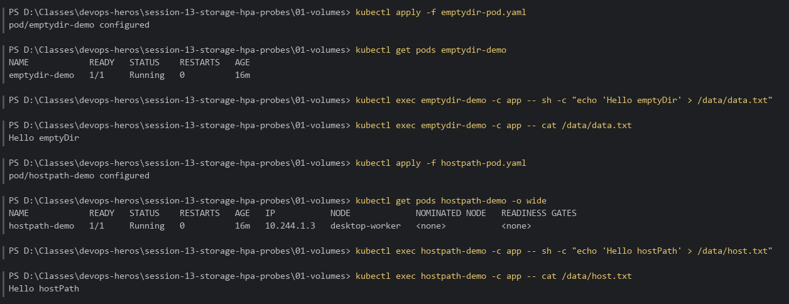
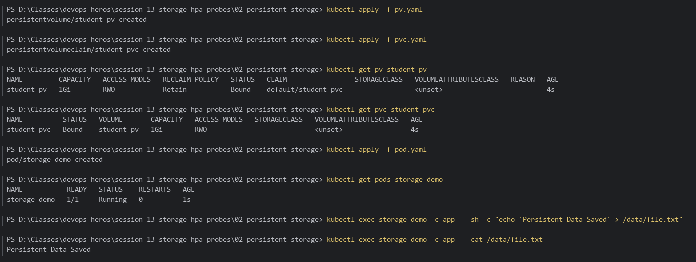
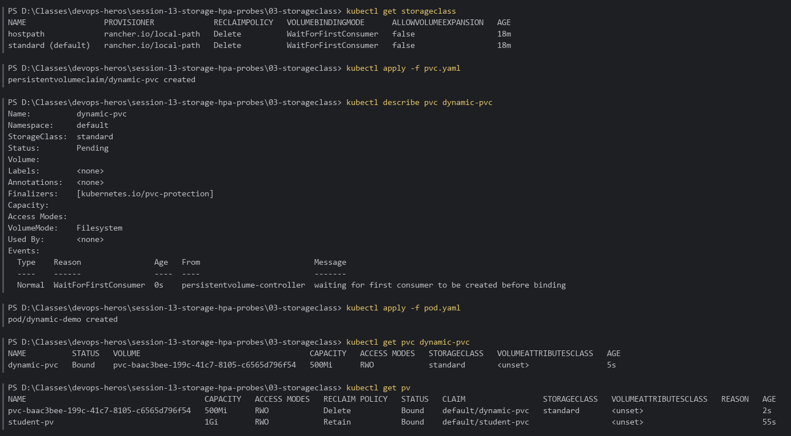
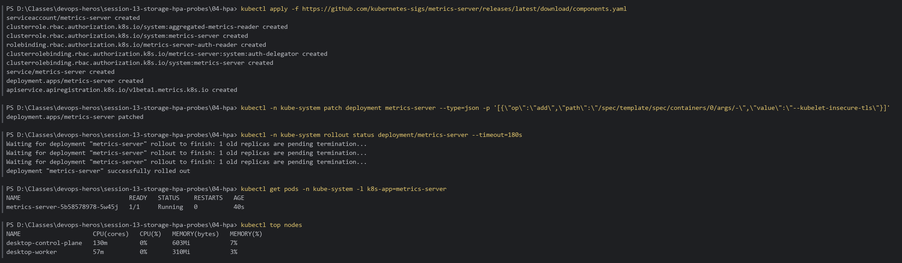
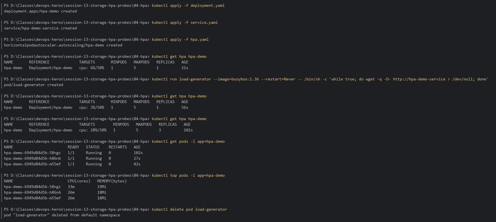
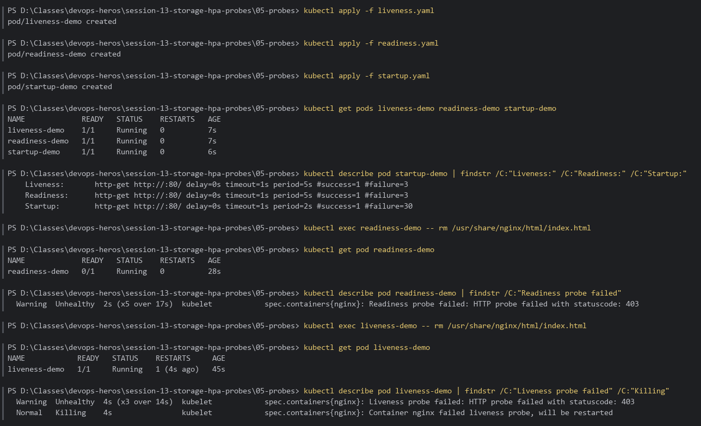
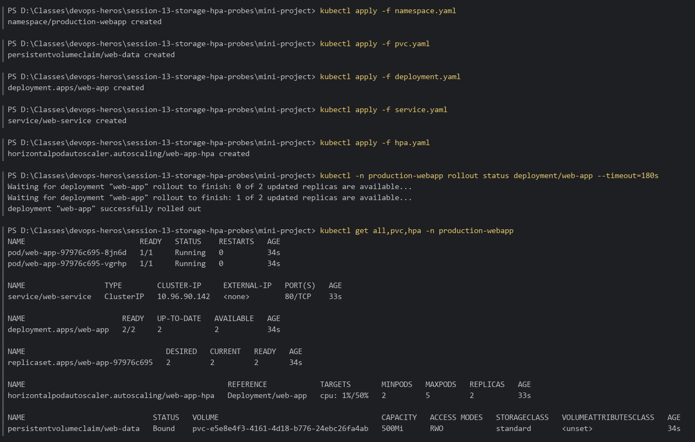

# Session 13 — Kubernetes Storage, HPA & Health Probes

Hands-on lab submission for Kubernetes volumes (emptyDir & hostPath), persistent storage (PV & PVC), dynamic provisioning (StorageClass), Horizontal Pod Autoscaling (HPA), and Health Probes (Liveness, Readiness, Startup).

**Environment:** Docker Desktop Kubernetes (`docker-desktop`, 2 nodes, v1.36), PowerShell, default StorageClass `standard` (`rancher.io/local-path`, `WaitForFirstConsumer`).

---

## Table of Contents

1. [Part 1 — Volumes: emptyDir & hostPath](#part-1--volumes-emptydir--hostpath)
2. [Part 2 — Persistent Storage: Static PV & PVC Binding](#part-2--persistent-storage-static-pv--pvc-binding)
3. [Part 3 — Dynamic Provisioning: StorageClass](#part-3--dynamic-provisioning-storageclass)
4. [Part 4 — Horizontal Pod Autoscaler (HPA)](#part-4--horizontal-pod-autoscaler-hpa)
5. [Part 5 — Health Probes: Liveness, Readiness & Startup](#part-5--health-probes-liveness-readiness--startup)
6. [Part 6 — Mini-Project: Integrated Production Workload](#part-6--mini-project-integrated-production-workload)

---

## Part 1 — Volumes: emptyDir & hostPath

### Why
- **emptyDir**: Ephemeral storage created when a Pod is assigned to a Node and deleted with the Pod. Useful for scratch data or caching.
- **hostPath**: Mounts a directory from the node's filesystem (`/tmp/hostpath-data`) into the container. Data outlives the Pod but is tied to that node.

### Commands Executed

```bash
cd session-13-storage-hpa-probes\01-volumes

kubectl apply -f emptydir-pod.yaml
kubectl get pods emptydir-demo
kubectl exec emptydir-demo -c app -- sh -c "echo 'Hello emptyDir' > /data/data.txt"
kubectl exec emptydir-demo -c app -- cat /data/data.txt

kubectl apply -f hostpath-pod.yaml
kubectl get pods hostpath-demo -o wide
kubectl exec hostpath-demo -c app -- sh -c "echo 'Hello hostPath' > /data/host.txt"
kubectl exec hostpath-demo -c app -- cat /data/host.txt
```

### Result
- `emptydir-demo` and `hostpath-demo` are `1/1 Running`.
- Data written to `/data/data.txt` and `/data/host.txt` is read back successfully.

### Terminal Proof / Screenshot



---

## Part 2 — Persistent Storage: Static PV & PVC Binding

### Why
Decouples storage administration from Pod creation. A **PersistentVolume** (`student-pv`) is storage provisioned by an admin; a **PersistentVolumeClaim** (`student-pvc`) is a workload's request for storage.

### Note — default StorageClass gotcha
On the first run, `student-pvc` stayed `Pending` and `student-pv` stayed `Available`: because the PVC had no `storageClassName`, the cluster's **default StorageClass (`standard`)** was applied to it and it waited for dynamic provisioning instead of binding to the static PV.
Fix applied in [`02-persistent-storage/pvc.yaml`](../02-persistent-storage/pvc.yaml):

```yaml
spec:
  storageClassName: ""   # bind to the static PV instead of the default StorageClass
```

### Commands Executed

```bash
cd session-13-storage-hpa-probes\02-persistent-storage

kubectl apply -f pv.yaml
kubectl apply -f pvc.yaml
kubectl get pv student-pv
kubectl get pvc student-pvc

kubectl apply -f pod.yaml
kubectl get pods storage-demo
kubectl exec storage-demo -c app -- sh -c "echo 'Persistent Data Saved' > /data/file.txt"
kubectl exec storage-demo -c app -- cat /data/file.txt
```

### Result
- PV `student-pv` → `Bound` to `default/student-pvc` (RWO, Retain).
- PVC `student-pvc` → `Bound` to `student-pv` (1Gi).
- Pod `storage-demo` writes and reads `/data/file.txt` on the persistent volume.

### Terminal Proof / Screenshot



---

## Part 3 — Dynamic Provisioning: StorageClass

### Why
Instead of manually creating PVs, a **StorageClass** provisions a PV on demand whenever a PVC requests it.

### Note — `WaitForFirstConsumer`
The `standard` StorageClass uses `volumeBindingMode: WaitForFirstConsumer`, so `dynamic-pvc` stays `Pending` (event: *waiting for first consumer to be created before binding*) until a Pod uses it. A small consumer Pod was added in [`03-storageclass/pod.yaml`](../03-storageclass/pod.yaml) to trigger provisioning.

### Commands Executed

```bash
cd session-13-storage-hpa-probes\03-storageclass

kubectl get storageclass
kubectl apply -f pvc.yaml
kubectl describe pvc dynamic-pvc     # Pending — WaitForFirstConsumer

kubectl apply -f pod.yaml            # consumer pod mounting dynamic-pvc
kubectl get pvc dynamic-pvc
kubectl get pv
```

### Result
- A new PV `pvc-<uid>` (500Mi, `Delete` reclaim policy, class `standard`) is created automatically.
- `dynamic-pvc` transitions `Pending` → `Bound`.

### Terminal Proof / Screenshot



---

## Part 4 — Horizontal Pod Autoscaler (HPA)

### Why
Automatically scales Deployment `hpa-demo` based on CPU utilization (target 50%, 1–5 replicas) to handle load spikes.

### Prerequisite — Metrics Server

HPA needs the Metrics API. Docker Desktop doesn't ship metrics-server, so it was installed and patched to accept the kubelet's self-signed certificates:

```bash
kubectl apply -f https://github.com/kubernetes-sigs/metrics-server/releases/latest/download/components.yaml
kubectl -n kube-system patch deployment metrics-server --type=json -p '[{\"op\":\"add\",\"path\":\"/spec/template/spec/containers/0/args/-\",\"value\":\"--kubelet-insecure-tls\"}]'
kubectl -n kube-system rollout status deployment/metrics-server
kubectl get pods -n kube-system -l k8s-app=metrics-server
kubectl top nodes
```



### Commands Executed

```bash
cd session-13-storage-hpa-probes\04-hpa

kubectl apply -f deployment.yaml
kubectl apply -f service.yaml
kubectl apply -f hpa.yaml
kubectl get hpa hpa-demo

# Generate CPU load
kubectl run load-generator --image=busybox:1.36 --restart=Never -- /bin/sh -c 'while true; do wget -q -O- http://hpa-demo-service > /dev/null; done'

kubectl get hpa hpa-demo
kubectl get pods -l app=hpa-demo
kubectl top pods -l app=hpa-demo
kubectl delete pod load-generator
```

### Result
- Baseline: `cpu: 6%/50%`, 1 replica.
- Under load CPU rose to `82%/50%`; HPA scaled `hpa-demo` **1 → 2 → 3** replicas, bringing average CPU back to ~28%.

### Terminal Proof / Screenshot



---

## Part 5 — Health Probes: Liveness, Readiness & Startup

### Why
- **Liveness Probe**: Restarts the container when the check fails.
- **Readiness Probe**: Removes the Pod from Service endpoints while the check fails (no restart).
- **Startup Probe**: Holds off liveness/readiness checks until a slow-starting app is up.

### Commands Executed

```bash
cd session-13-storage-hpa-probes\05-probes

kubectl apply -f liveness.yaml
kubectl apply -f readiness.yaml
kubectl apply -f startup.yaml
kubectl get pods liveness-demo readiness-demo startup-demo
kubectl describe pod startup-demo | findstr /C:"Liveness:" /C:"Readiness:" /C:"Startup:"

# Break readiness: nginx now returns 403 on /
kubectl exec readiness-demo -- rm /usr/share/nginx/html/index.html
kubectl get pod readiness-demo
kubectl describe pod readiness-demo | findstr /C:"Readiness probe failed"

# Break liveness: kubelet restarts the container
kubectl exec liveness-demo -- rm /usr/share/nginx/html/index.html
kubectl get pod liveness-demo
kubectl describe pod liveness-demo | findstr /C:"Liveness probe failed" /C:"Killing"
```

### Result
- All three Pods start `1/1 Running`; `startup-demo` shows all three probes configured.
- **Readiness failure** → `readiness-demo` drops to `0/1 Ready` but is **not** restarted (`Readiness probe failed: ... statuscode: 403`).
- **Liveness failure** → `liveness-demo` is killed and restarted (`RESTARTS 1`, `Container nginx failed liveness probe, will be restarted`), and the fresh container is healthy again.

### Terminal Proof / Screenshot



---

## Part 6 — Mini-Project: Integrated Production Workload

### Why
Combines everything into a production-style stack in namespace `production-webapp`: Namespace, PVC (`web-data`), resource requests/limits, startup/readiness/liveness probes, `Recreate` strategy, ClusterIP Service, and HPA (`web-app-hpa`, 2–5 replicas).

### Commands Executed

```bash
cd session-13-storage-hpa-probes\mini-project

kubectl apply -f namespace.yaml
kubectl apply -f pvc.yaml
kubectl apply -f deployment.yaml
kubectl apply -f service.yaml
kubectl apply -f hpa.yaml
kubectl -n production-webapp rollout status deployment/web-app

kubectl get all,pvc,hpa -n production-webapp
```

### Result
- `web-app` Deployment `2/2` ready, Service `web-service` (ClusterIP) created.
- PVC `web-data` `Bound` via the `standard` StorageClass.
- HPA `web-app-hpa` reading metrics (`cpu: 1%/50%`, min 2 / max 5).

### Terminal Proof / Screenshot



---

## Lab Cleanup

```bash
kubectl delete -f mini-project/
kubectl delete -f 05-probes/
kubectl delete -f 04-hpa/deployment.yaml -f 04-hpa/service.yaml -f 04-hpa/hpa.yaml
kubectl delete -f 03-storageclass/
kubectl delete -f 02-persistent-storage/
kubectl delete -f 01-volumes/
```
