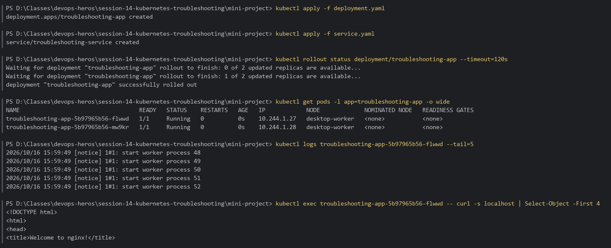
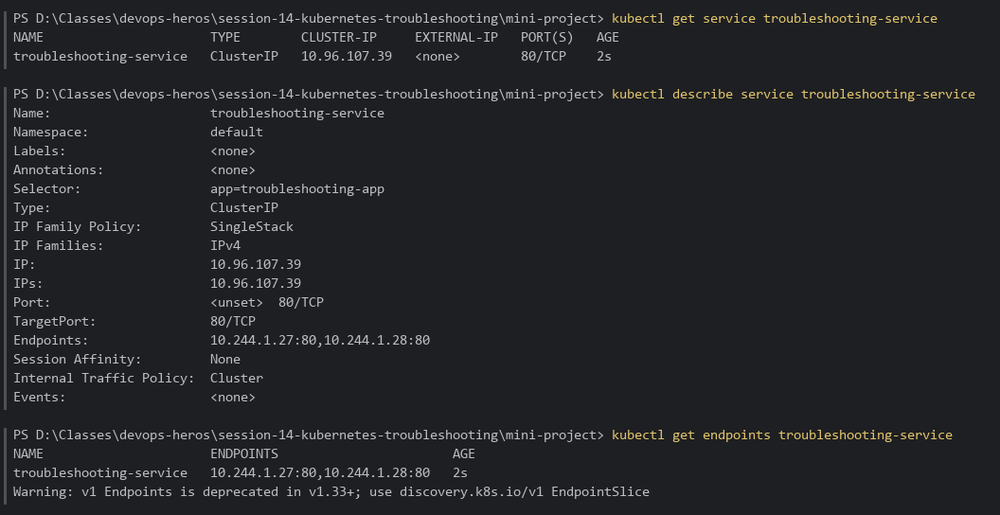
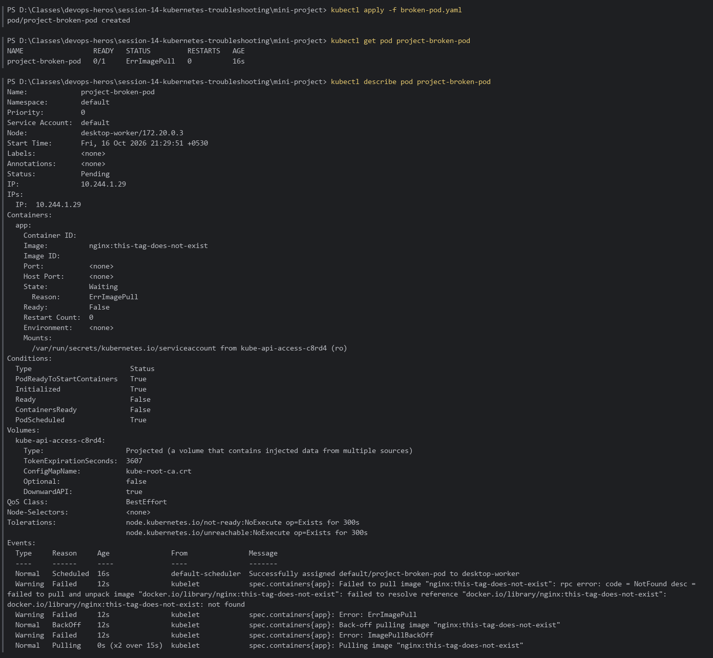
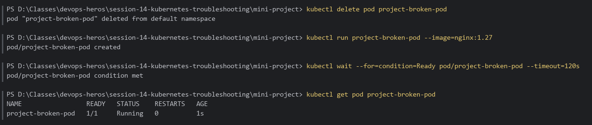
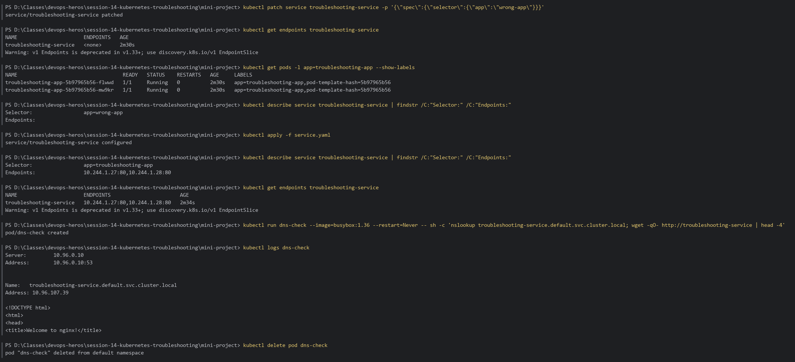

# Session 14 — Kubernetes Troubleshooting: Mini-Project

Submission for the **Kubernetes Troubleshooting Challenge** ([`mini-project/README.md`](../mini-project/README.md)): deploy → observe → break → investigate → find root cause → fix → verify.

> Parts 01–09 (get / describe / logs / exec / events / CrashLoopBackOff / ImagePullBackOff / Pending / Service-DNS) are documented with screenshots inside each task folder (`01-kubectl-get/img.png`, …).

**Environment:** Docker Desktop Kubernetes (`docker-desktop`, v1.36), PowerShell.

---

## Table of Contents

1. [Step 1–2 — Deploy & Check the Application](#step-12--deploy--check-the-application)
2. [Step 3–4 — Check the Service & Endpoints](#step-34--check-the-service--endpoints)
3. [Step 5–7 — Broken Pod Investigation](#step-57--broken-pod-investigation)
4. [Step 8–9 — Service Selector Challenge](#step-89--service-selector-challenge)
5. [Troubleshooting Table](#troubleshooting-table)
6. [README Questions](#readme-questions)

---

## Step 1–2 — Deploy & Check the Application

```bash
cd session-14-kubernetes-troubleshooting\mini-project

kubectl apply -f deployment.yaml
kubectl apply -f service.yaml
kubectl rollout status deployment/troubleshooting-app
kubectl get pods -l app=troubleshooting-app -o wide
kubectl logs <pod-name> --tail=5
kubectl exec <pod-name> -- curl -s localhost
```

**Result:** 2 replicas of `troubleshooting-app` are `Running` across the worker node; nginx logs show a clean start, and `curl localhost` inside the container returns the nginx welcome page.



---

## Step 3–4 — Check the Service & Endpoints

```bash
kubectl get service troubleshooting-service
kubectl describe service troubleshooting-service
kubectl get endpoints troubleshooting-service
```

**Result:** Selector `app=troubleshooting-app`, `TargetPort 80/TCP`, and the Endpoints list both Pod IPs.



---

## Step 5–7 — Broken Pod Investigation

```bash
kubectl apply -f broken-pod.yaml
kubectl get pod project-broken-pod
kubectl describe pod project-broken-pod
```



### Answers

| # | Question                              | Answer                                                                                                                           |
|:--|:--------------------------------------|:---------------------------------------------------------------------------------------------------------------------------------|
| 1 | What is the Pod status?               | `ImagePullBackOff` (alternating with `ErrImagePull`), `0/1 READY`.                                                               |
| 2 | What is the actual error?             | `Failed to pull image "nginx:this-tag-does-not-exist": ... code = NotFound` → `Error: ErrImagePull` → `Error: ImagePullBackOff`. |
| 3 | Which command helped find the reason? | `kubectl describe pod project-broken-pod` — the **Events** section shows the failed pull.                                        |
| 4 | What is wrong with the image?         | The repository `nginx` exists, but the tag `this-tag-does-not-exist` does not exist on Docker Hub.                               |
| 5 | How would you fix it?                 | Use a valid tag (e.g. `nginx:1.27`). Pod image fields are immutable, so delete and recreate the Pod with the correct image.      |

### Fix & Verify

```bash
kubectl delete pod project-broken-pod
kubectl run project-broken-pod --image=nginx:1.27
kubectl get pod project-broken-pod
```



---

## Step 8–9 — Service Selector Challenge

Break the Service selector (`app: troubleshooting-app` → `app: wrong-app`), investigate, then fix by re-applying the original `service.yaml`:

```bash
kubectl patch service troubleshooting-service -p '{\"spec\":{\"selector\":{\"app\":\"wrong-app\"}}}'
kubectl get endpoints troubleshooting-service            # <none>
kubectl get pods -l app=troubleshooting-app --show-labels
kubectl describe service troubleshooting-service | findstr /C:"Selector:" /C:"Endpoints:"

kubectl apply -f service.yaml                            # restore selector
kubectl describe service troubleshooting-service | findstr /C:"Selector:" /C:"Endpoints:"
kubectl get endpoints troubleshooting-service

# Verify DNS + HTTP from inside the cluster
kubectl run dns-check --image=busybox:1.36 --restart=Never -- sh -c 'nslookup troubleshooting-service.default.svc.cluster.local; wget -qO- http://troubleshooting-service | head -4'
kubectl logs dns-check
kubectl delete pod dns-check
```

**Result:** With `app=wrong-app` the Service has **no endpoints** because Pods are labelled `app=troubleshooting-app`. After restoring the selector, both Pod IPs reappear, the Service name resolves via CoreDNS (`10.96.0.10`), and HTTP returns the nginx page.



---

## Troubleshooting Table

| Problem             | What I Saw                                           | Command I Used                                                                        | Root Cause                                             | Fix                                                                          |
|:--------------------|:-----------------------------------------------------|:--------------------------------------------------------------------------------------|:-------------------------------------------------------|:-----------------------------------------------------------------------------|
| **Broken Pod**      | `project-broken-pod` stuck `0/1`, `ImagePullBackOff` | `kubectl get pod`, `kubectl describe pod`                                             | Container image could not be pulled                    | Recreate the Pod with a valid image                                          |
| **Service Problem** | `ENDPOINTS <none>`; traffic to the Service fails     | `kubectl get endpoints`, `kubectl describe service`, `kubectl get pods --show-labels` | Service selector `app=wrong-app` matches no Pod labels | Restore selector `app=troubleshooting-app` (`kubectl apply -f service.yaml`) |
| **Image Problem**   | `Failed to pull image ... NotFound` in Events        | `kubectl describe pod` (Events)                                                       | Tag `this-tag-does-not-exist` doesn't exist            | Use an existing tag, e.g. `nginx:1.27`                                       |

---

## README Questions

1. **What does `kubectl get` tell us?** A quick summary of resources — status, ready count, restarts, age, and with `-o wide` the Pod IP and node.
2. **Difference between `get` and `describe`?** `get` is a one-line overview; `describe` shows full detail — config, conditions, container state, and the Events history that usually explains *why*.
3. **Why use `kubectl logs`?** To read the container's stdout/stderr and debug application-level errors (crashes, bad config, connection failures). `--previous` shows logs of a crashed container.
4. **When use `kubectl exec`?** When you need to look inside a running container — check files/env, test `curl localhost`, or test DNS/network from the Pod's point of view.
5. **What does `CrashLoopBackOff` mean?** The container starts and keeps exiting; kubelet restarts it with an increasing back-off delay.
6. **What does `ImagePullBackOff` mean?** The kubelet can't pull the image (wrong name/tag, private registry without credentials, network) and is backing off between retries.
7. **Why can a Pod remain `Pending`?** The scheduler can't place it — insufficient CPU/memory, unsatisfiable nodeSelector/affinity/taints, or an unbound PVC.
8. **Why can a Service have no endpoints?** Its selector matches no Pods, or the matching Pods aren't Ready (failing readiness probes).
9. **Service selector vs Pod labels?** The Service selects Pods by label; only Pods whose labels match the selector (and are Ready) become its endpoints.
10. **What is Kubernetes DNS?** CoreDNS gives every Service a name — `<service>.<namespace>.svc.cluster.local` — so Pods reach Services by name instead of IP.

---

## Lab Cleanup

```bash
kubectl delete -f mini-project/
```
