# Session 15: Helm — Package Management for Kubernetes

Hands-on verification for Kubernetes package management with Helm: chart scaffolding, structure, values overrides, Go templating, the release lifecycle (install / upgrade / rollback), and a packaged Notes app.

**Environment:** Helm **v4.3.1**, Docker Desktop Kubernetes (`docker-desktop`, v1.36), PowerShell.

---

## Table of Contents

- [Overview](#overview)
- [Part 1 — What is Helm?](#part-1--what-is-helm)
- [Part 2 — Helm Charts](#part-2--helm-charts)
- [Part 3 — Chart Structure](#part-3--chart-structure)
- [Part 4 — Chart.yaml](#part-4--chartyaml)
- [Part 5 — values.yaml & Overrides](#part-5--valuesyaml--overrides)
- [Part 6 — Templates](#part-6--templates)
- [Part 7 — Install & Upgrade](#part-7--install--upgrade)
- [Part 8 — Rollback](#part-8--rollback)
- [Part 9 — Deploying an Application with Helm](#part-9--deploying-an-application-with-helm)
- [Part 10 — Mini-Project: Notes App](#part-10--mini-project-notes-app)

---

## Overview

- **Chart**: a reusable, parameterized package of Kubernetes manifests.
- **Values**: environment-specific inputs injected into templates at render time.
- **Release**: an installed instance of a chart, with a versioned revision history that enables upgrade and rollback.

---

## Part 1 — What is Helm?

```bash
cd session-15-helm\01-what-is-helm
helm version
helm list
```

**Result:** Helm client `v4.3.1` (client-only, no Tiller); `helm list` shows an empty release table.

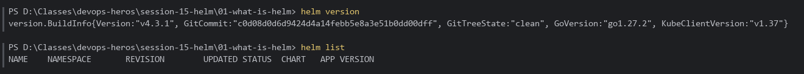

---

## Part 2 — Helm Charts

```bash
cd session-15-helm\02-helm-charts
helm create hello-chart
Get-ChildItem -Recurse hello-chart | Select-Object -ExpandProperty FullName | Resolve-Path -Relative
helm lint hello-chart
helm lint demo-chart
```

**Result:** `helm create` scaffolds `Chart.yaml`, `values.yaml`, `charts/`, and `templates/` (deployment, service, ingress, hpa, httproute, serviceaccount, NOTES.txt, `_helpers.tpl`, tests). Both charts lint with `0 chart(s) failed`.
*(`hello-chart` was a throwaway scaffold and was removed afterwards.)*

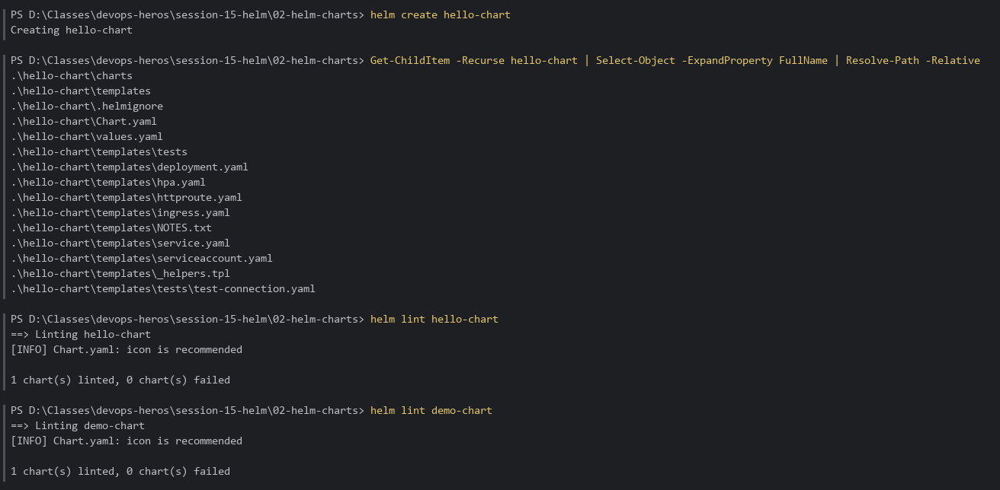

---

## Part 3 — Chart Structure

```bash
cd session-15-helm\03-chart-structure
tree /F /A simple-chart
helm template my-release simple-chart
```

**Result:** Minimal chart layout (`Chart.yaml`, `values.yaml`, `templates/deployment.yaml`, `templates/service.yaml`) rendered locally into plain Kubernetes YAML with default values filled in.

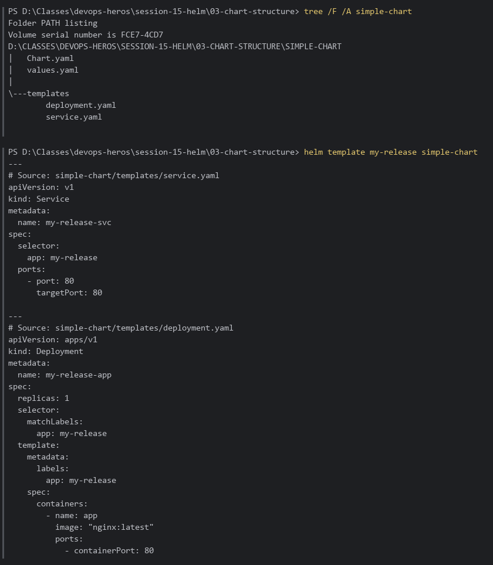

---

## Part 4 — Chart.yaml

```bash
cd session-15-helm\04-chart-yaml
Get-Content Chart.yaml
helm show chart ..\03-chart-structure\simple-chart
```

**Result:** Shows `apiVersion: v2`, `name`, `description`, `type`, `version` (the **chart** package version) and `appVersion` (the **application** version).

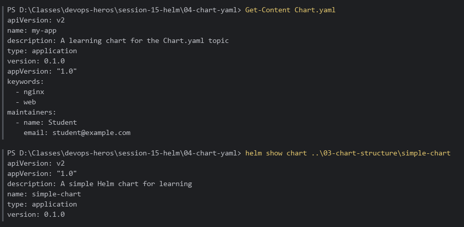

---

## Part 5 — values.yaml & Overrides

```bash
cd session-15-helm\05-values-yaml
helm lint my-app
helm template my-app .\my-app                          | Select-String "replicas:|image:"
helm template my-app .\my-app -f values-prod.yaml      | Select-String "replicas:|image:"
helm template my-app .\my-app --set replicaCount=3     | Select-String "replicas:|image:"
```

| Source                          | replicas | image          |
|:--------------------------------|:---------|:---------------|
| defaults (`my-app/values.yaml`) | 1        | `nginx:1.16.0` |
| `-f values-prod.yaml`           | 5        | `nginx:latest` |
| `--set replicaCount=3`          | 3        | `nginx:1.16.0` |

Precedence: chart defaults < `-f` file < `--set`.

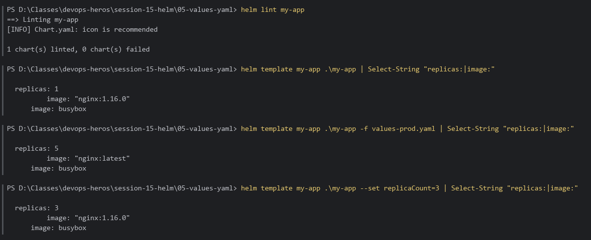

---

## Part 6 — Templates

```bash
cd session-15-helm\06-templates
Get-Content template-demo\templates\deployment.yaml
helm template my-release template-demo
helm template my-release template-demo --set replicaCount=5 | Select-String "replicas:"
helm template my-release template-demo --set service.enabled=false
```

**Result:** `{{ .Release.Name }}` and `{{ .Values.* }}` render into the Deployment and Service. Setting `service.enabled=false` makes the `{{- if .Values.service.enabled }}` block drop the Service entirely, so only the Deployment is rendered.

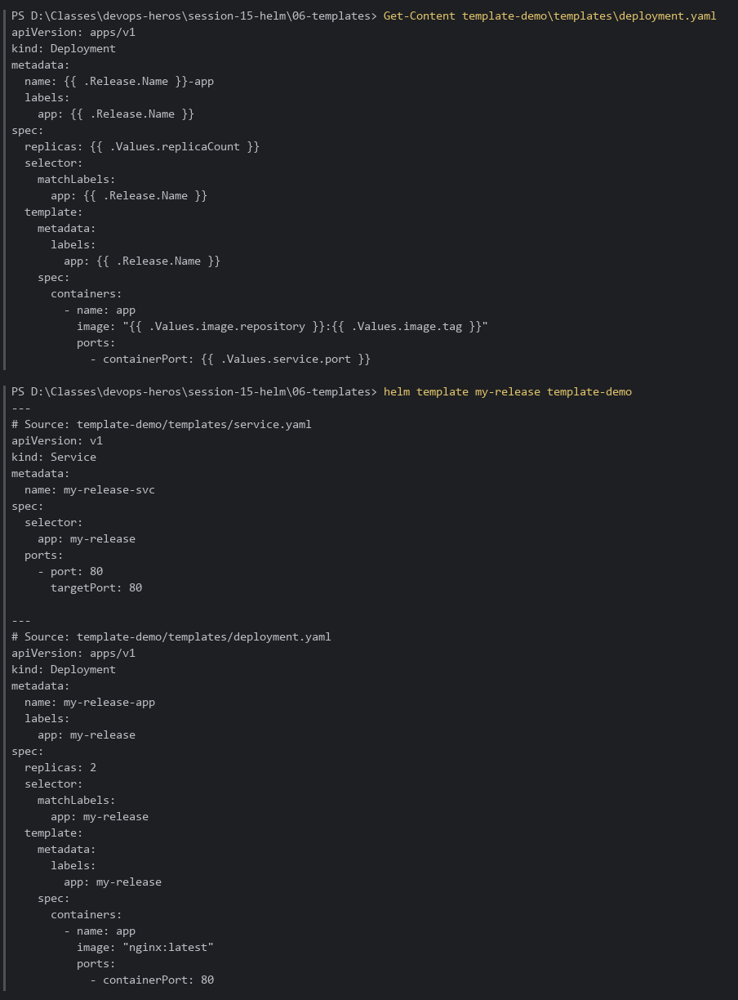
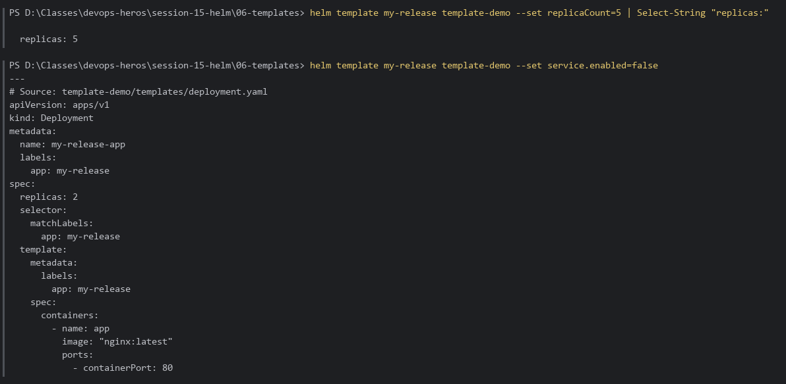

---

## Part 7 — Install & Upgrade

```bash
cd session-15-helm\07-install-upgrade
helm install web-app ./app-chart
helm list
kubectl get pods -l app=web-app
helm upgrade web-app ./app-chart --set replicaCount=3
helm history web-app
kubectl get pods -l app=web-app
helm upgrade --install web-app ./app-chart
helm uninstall web-app
```

**Result:** Install → `REVISION 1 deployed` with 1 Pod; upgrade → `REVISION 2` with 3 Pods (revision 1 `superseded`); `upgrade --install` on an existing release creates `REVISION 3`.

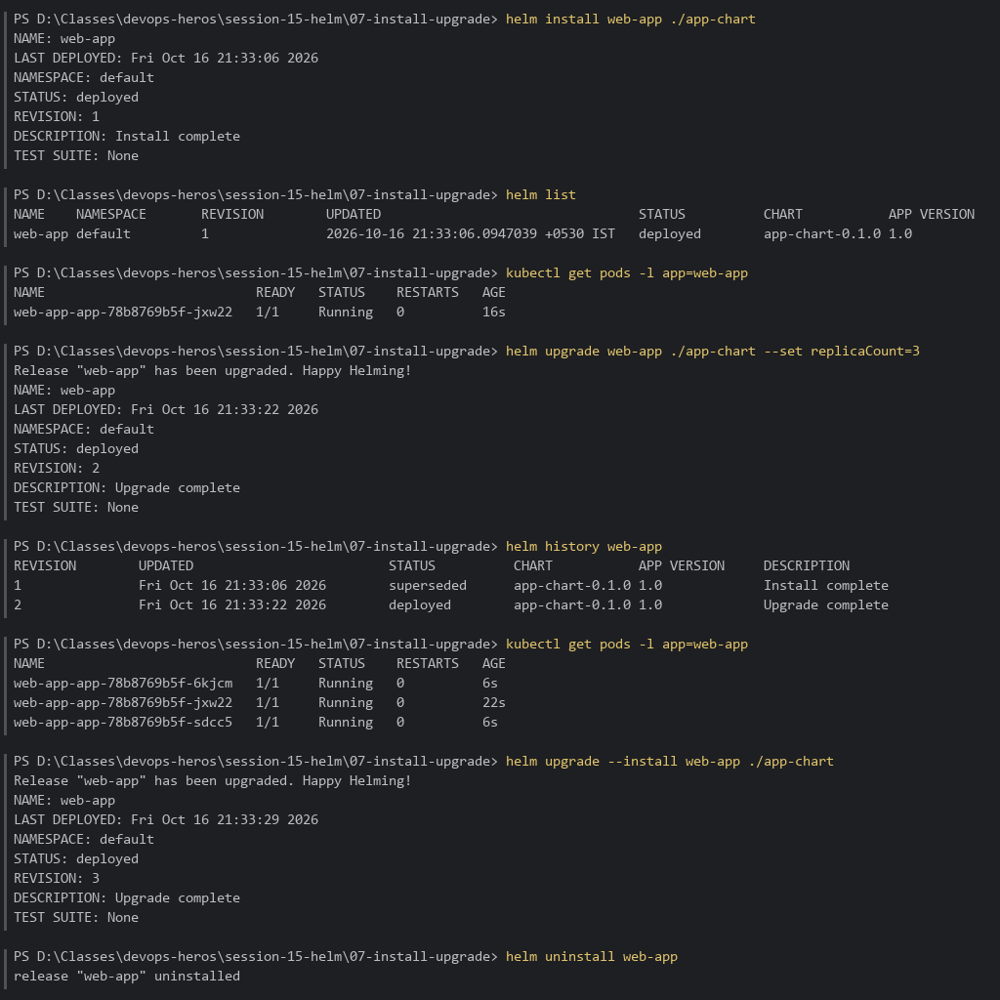

---

## Part 8 — Rollback

```bash
cd session-15-helm\07-install-upgrade
helm install rollback-demo ./app-chart
helm upgrade rollback-demo ./app-chart --set image.tag=doesnotexist
kubectl get pods -l app=rollback-demo          # ErrImagePull / ImagePullBackOff
helm history rollback-demo
helm rollback rollback-demo 1
kubectl get pods -l app=rollback-demo          # healthy again
helm history rollback-demo                     # REVISION 3: "Rollback to 1"
```

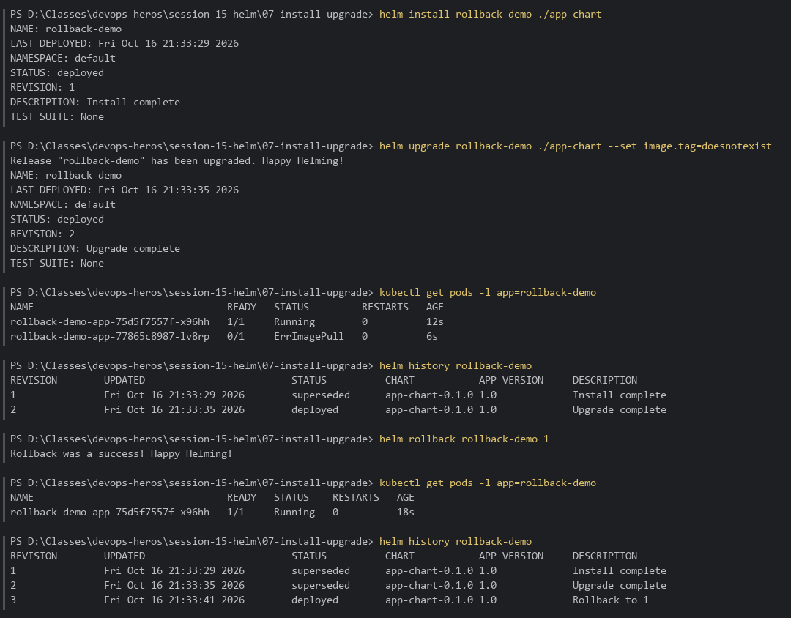

### Automatic rollback on failure

In **Helm 4**, `--atomic` was renamed to **`--rollback-on-failure`**:

```bash
helm upgrade rollback-demo ./app-chart --set image.tag=doesnotexist --rollback-on-failure --timeout 60s
helm history rollback-demo
helm uninstall rollback-demo
```

**Result:** The upgrade fails (`UPGRADE FAILED ... has been rolled back due to rollback-on-failure being set`) and Helm automatically restores the last good revision, with no manual step needed.

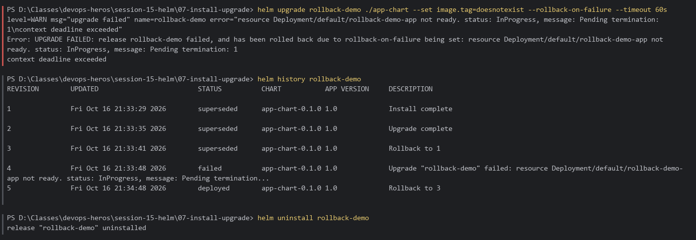

---

## Part 9 — Deploying an Application with Helm

```bash
cd session-15-helm\09-deploying-application
helm lint guestbook-chart
helm install my-guestbook guestbook-chart
kubectl get pods,services,configmaps
helm upgrade my-guestbook guestbook-chart --set replicaCount=3
kubectl get pods -l app=my-guestbook
helm rollback my-guestbook 1
helm history my-guestbook
helm uninstall my-guestbook
```

**Result:** The guestbook chart (Deployment + Service + ConfigMap) lints cleanly, installs, scales to 3 replicas, and rolls back to revision 1.

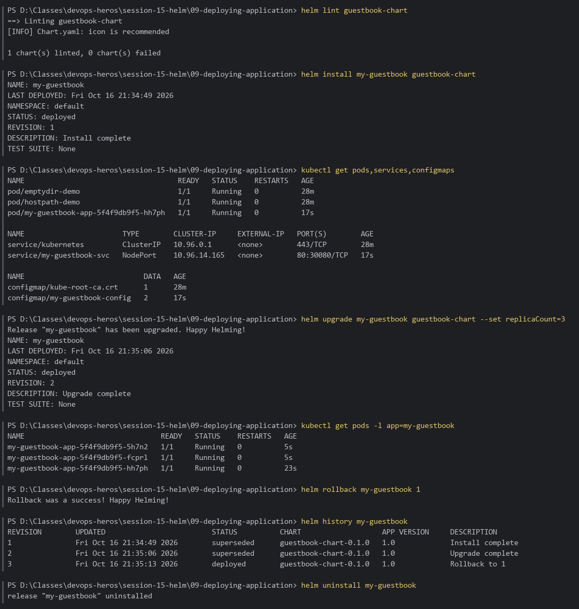

---

## Part 10 — Mini-Project: Notes App

```bash
cd session-15-helm\mini-project

# Lint & render
helm lint notes-chart
helm template notes-dev notes-chart

# Install (development) → upgrade with production values
helm install notes-dev notes-chart
kubectl get pods,services,configmaps
helm upgrade notes-dev notes-chart -f notes-chart/values-prod.yaml
kubectl get pods -l app=notes-dev
helm history notes-dev

# Simulate a bad upgrade → roll back to revision 2
helm upgrade notes-dev notes-chart --set image.tag=broken-tag-does-not-exist
kubectl get pods -l app=notes-dev
helm rollback notes-dev 2
kubectl get pods -l app=notes-dev
helm history notes-dev
helm uninstall notes-dev
```

**Result:**
- Dev release: 1 Pod (`nginx:1.24`), NodePort Service `notes-dev-svc` (`80:30090`), ConfigMap `notes-dev-config`.
- Production values: 3 Pods (`nginx:1.25`), revision 2.
- Broken tag → new Pod in `ErrImagePull` while the old ReplicaSet keeps serving; `helm rollback notes-dev 2` → revision 4 *"Rollback to 2"*, 3 healthy Pods.

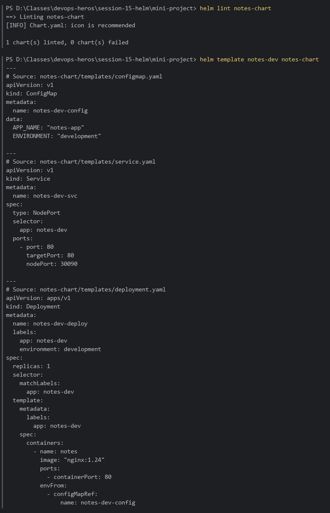
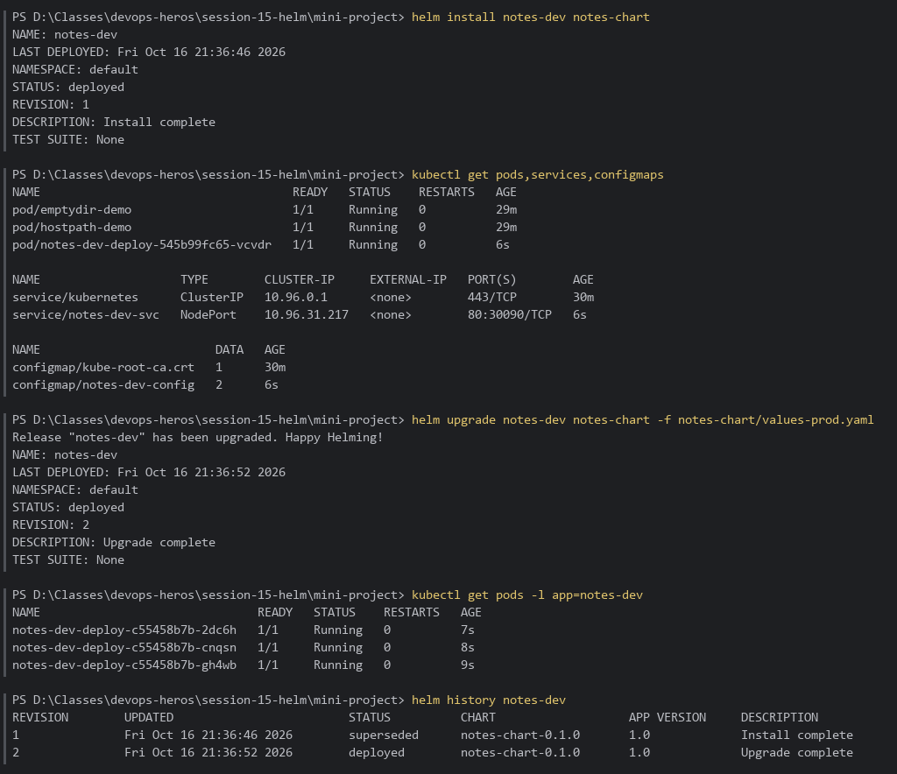
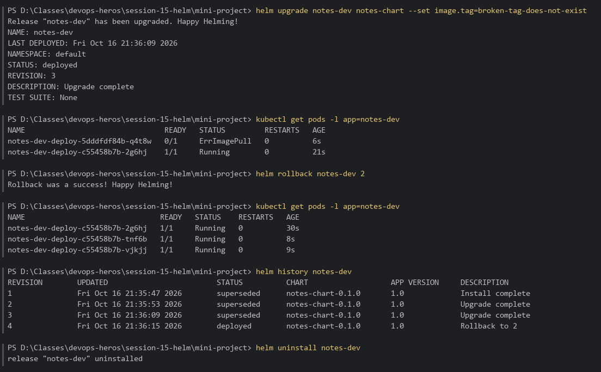
