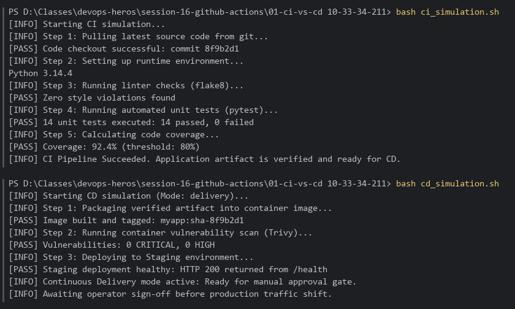
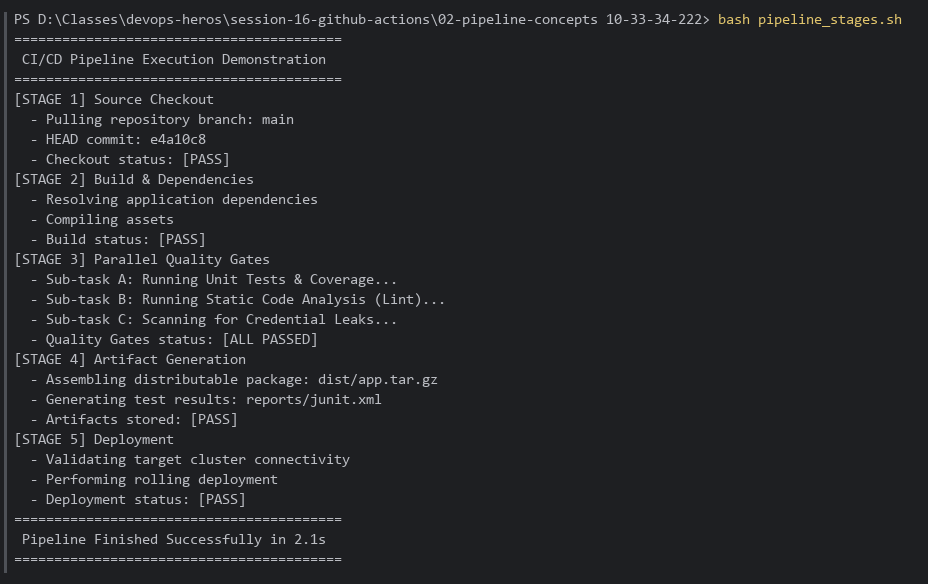
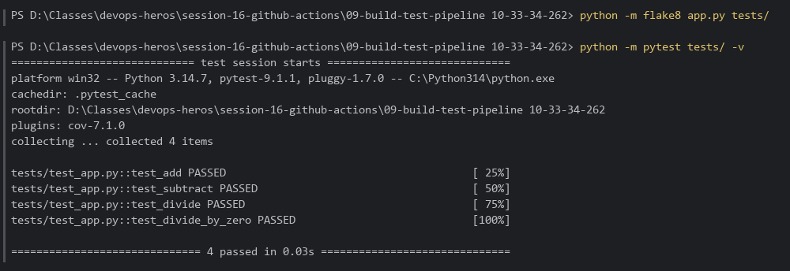
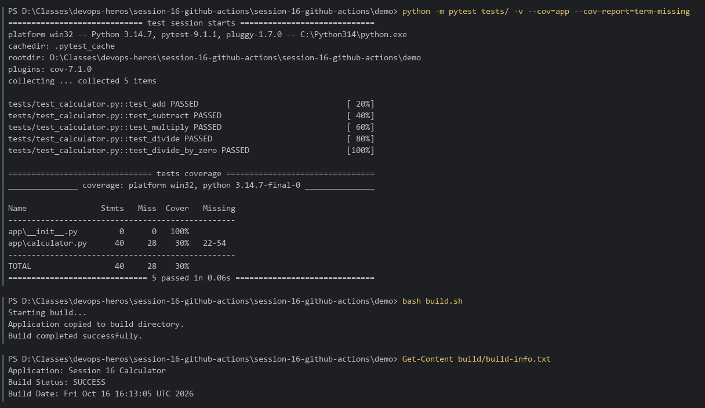
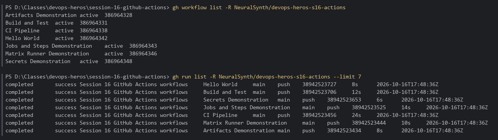
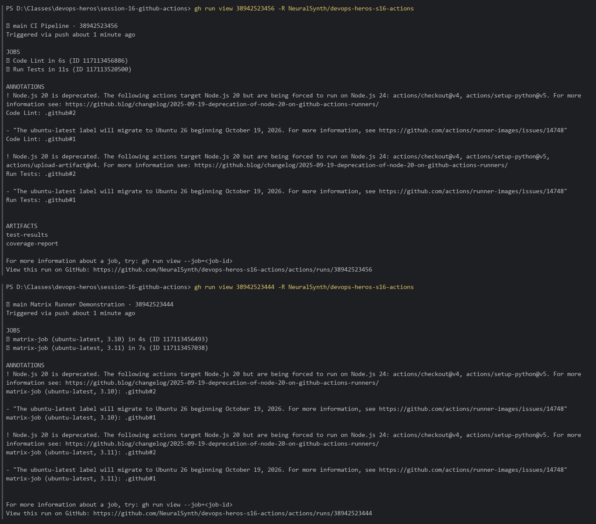
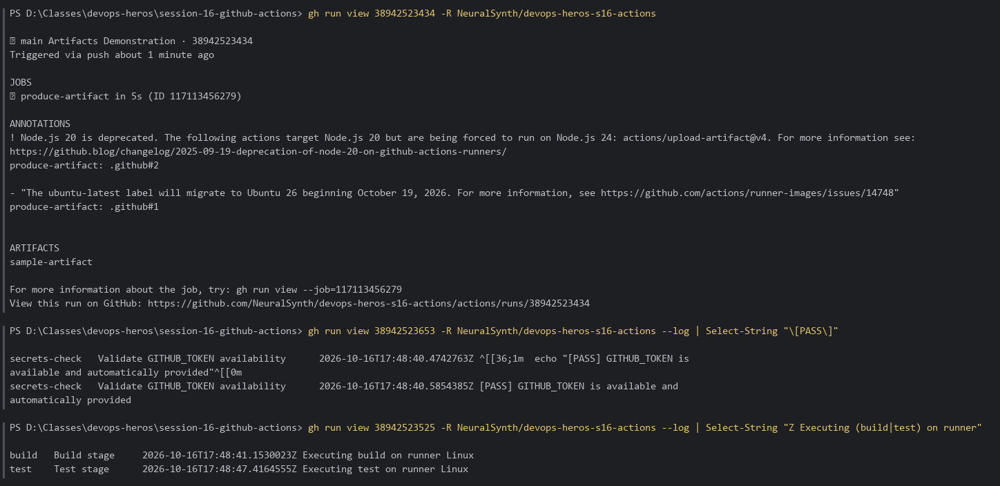

# Session 16: CI/CD with GitHub Actions

Verification of CI/CD concepts and the GitHub Actions workflows in this session: the local CI/CD simulations and build/test stages (screenshots below), plus the GitHub-hosted workflow runs (staged for completion on GitHub).

**Environment:** Windows 11, PowerShell, Git Bash (`bash`), Python 3.14, pytest 9, flake8.

---

## Table of Contents

- [Part 1 — CI vs CD Simulation](#part-1--ci-vs-cd-simulation)
- [Part 2 — Pipeline Stages](#part-2--pipeline-stages)
- [Part 3 — Build & Test Pipeline (lint + pytest)](#part-3--build--test-pipeline-lint--pytest)
- [Part 4 — Demo App: Tests, Coverage & Build Artifact](#part-4--demo-app-tests-coverage--build-artifact)
- [Part 5 — GitHub Actions Workflow Runs](#part-5--github-actions-workflow-runs)

---

## Part 1 — CI vs CD Simulation

```bash
cd "session-16-github-actions\01-ci-vs-cd 10-33-34-211"
bash ci_simulation.sh
bash cd_simulation.sh
```

**Result:** **CI** covers checkout → runtime setup → lint → unit tests → coverage gate (92.4% ≥ 80%), producing a verified artifact. **CD** covers image build/tag → vulnerability scan → staging deploy → health check (HTTP 200 on `/health`).



---

## Part 2 — Pipeline Stages

```bash
cd "session-16-github-actions\02-pipeline-concepts 10-33-34-222"
bash pipeline_stages.sh
```

**Result:** Source → Build & Dependencies → Quality Gates → Artifacts → Deploy, each stage reporting `[PASS]`.



---

## Part 3 — Build & Test Pipeline (lint + pytest)

These are the same commands the `lint` and `test` jobs of [`ci.yml`](../09-build-test-pipeline%2010-33-34-262/ci.yml) run:

```bash
cd "session-16-github-actions\09-build-test-pipeline 10-33-34-262"
python -m flake8 app.py tests/
python -m pytest tests/ -v
```

**Result:** flake8 reports no violations; `4 passed` (`test_add`, `test_subtract`, `test_divide`, `test_divide_by_zero`).



---

## Part 4 — Demo App: Tests, Coverage & Build Artifact

```bash
cd session-16-github-actions\session-16-github-actions\demo
python -m pytest tests/ -v --cov=app --cov-report=term-missing
bash build.sh
Get-Content build/build-info.txt
```

**Result:**
- `5 passed` for the calculator (`add`, `subtract`, `multiply`, `divide`, `divide_by_zero`).
- Coverage **30%** for `app/calculator.py`: lines 22–54 are untested, a good candidate for more tests.
- `build.sh` produces the `build/` artifact (`calculator.py` + `build-info.txt`, *Build Status: SUCCESS*). This is what `actions/upload-artifact` uploads in CI.

> The `.sh` scripts had been checked out with Windows CRLF line endings, which breaks `bash` (`set: -\r: invalid option`). They were normalized to LF; the git index already stores LF, so there's no content diff.



---

## Part 5 — GitHub Actions Workflow Runs

GitHub only runs workflows from `.github/workflows/` at the **root** of a repository, so the seven Session 16 workflows were copied to the root of a dedicated public repo, together with the `09-build-test-pipeline` app (`app.py`, `tests/`, `requirements.txt`) that `build.yml` and `ci.yml` test:

**Repo:** <https://github.com/NeuralSynth/devops-heros-s16-actions> · **Actions:** <https://github.com/NeuralSynth/devops-heros-s16-actions/actions>

| Workflow | Source folder | Concept | Result |
| :--- | :--- | :--- | :--- |
| Hello World | 03-github-actions-intro | First workflow on `push` | ✅ |
| Build and Test | 04-workflows | push/PR triggers, setup-python, pytest | ✅ |
| Jobs and Steps Demonstration | 05-jobs-steps | Two jobs, multiple steps | ✅ |
| Matrix Runner Demonstration | 06-runners | Matrix over Python 3.10 / 3.11 | ✅ (2 jobs) |
| Secrets Demonstration | 07-secrets | `secrets.GITHUB_TOKEN` (never printed) | ✅ |
| Artifacts Demonstration | 08-artifacts | `actions/upload-artifact` → `sample-artifact` | ✅ |
| CI Pipeline | 09-build-test-pipeline | lint → test + coverage → artifacts `test-results`, `coverage-report` | ✅ |

All 7 workflows ran on the first push and passed.

```powershell
gh workflow list -R NeuralSynth/devops-heros-s16-actions
gh run list      -R NeuralSynth/devops-heros-s16-actions --limit 7
gh run view <RUN_ID> -R NeuralSynth/devops-heros-s16-actions          # jobs + artifacts
gh run view <RUN_ID> -R NeuralSynth/devops-heros-s16-actions --log    # full logs
```





> The runs show GitHub's notice that Node.js 20 actions (`actions/checkout@v4`, `setup-python@v5`, `upload-artifact@v4`) are being forced onto Node.js 24. They still pass; bumping to the next major versions removes the warning.
