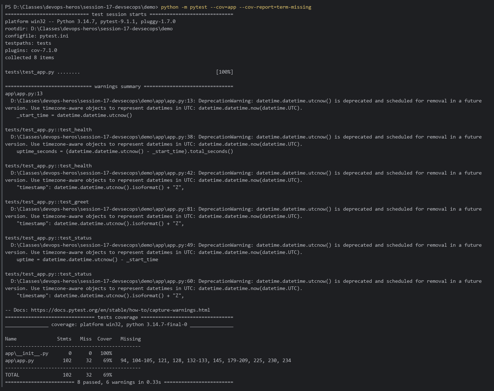
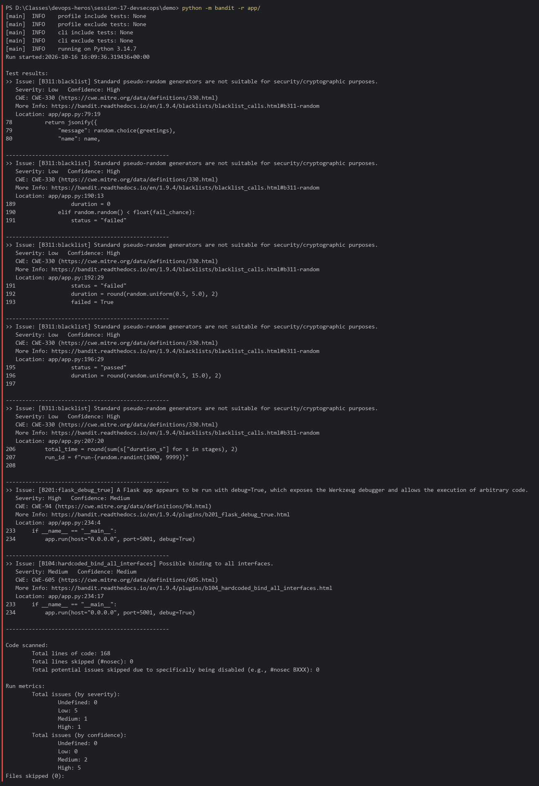
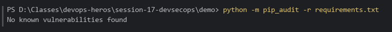
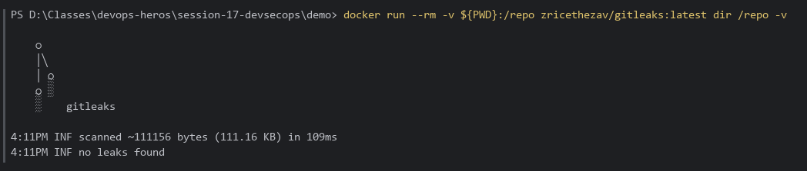
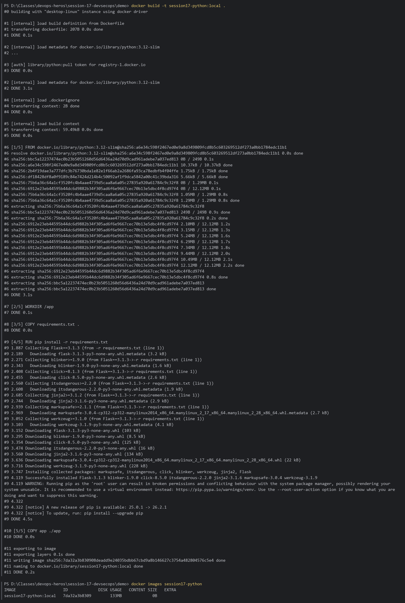
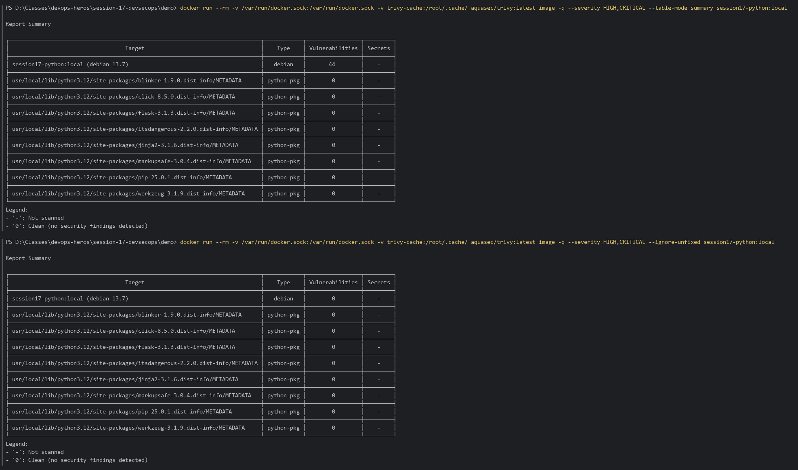
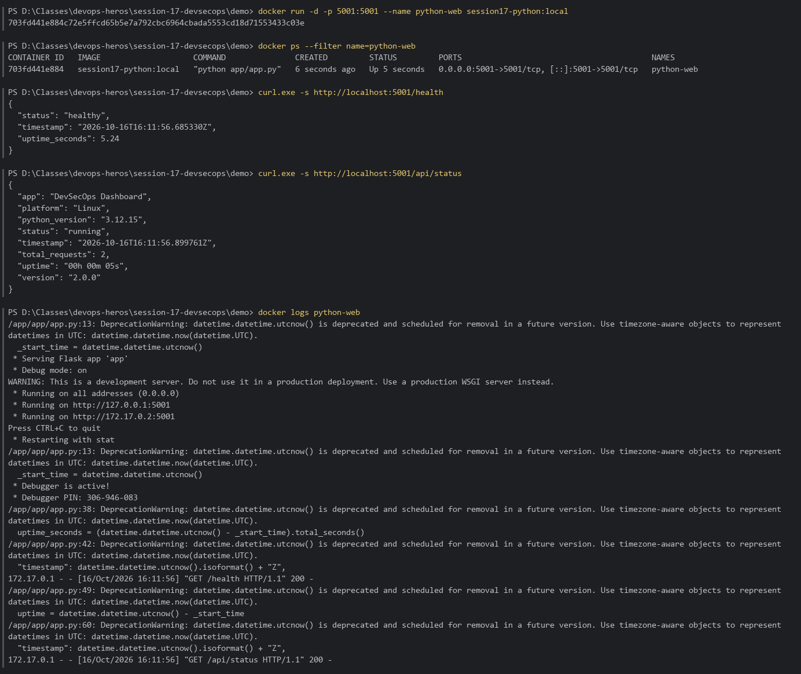
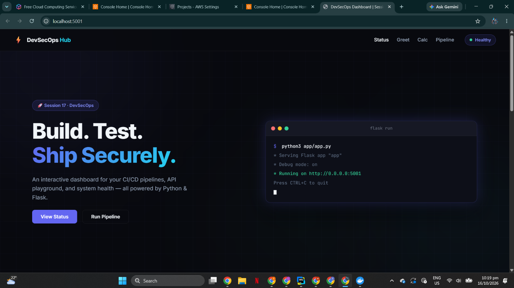
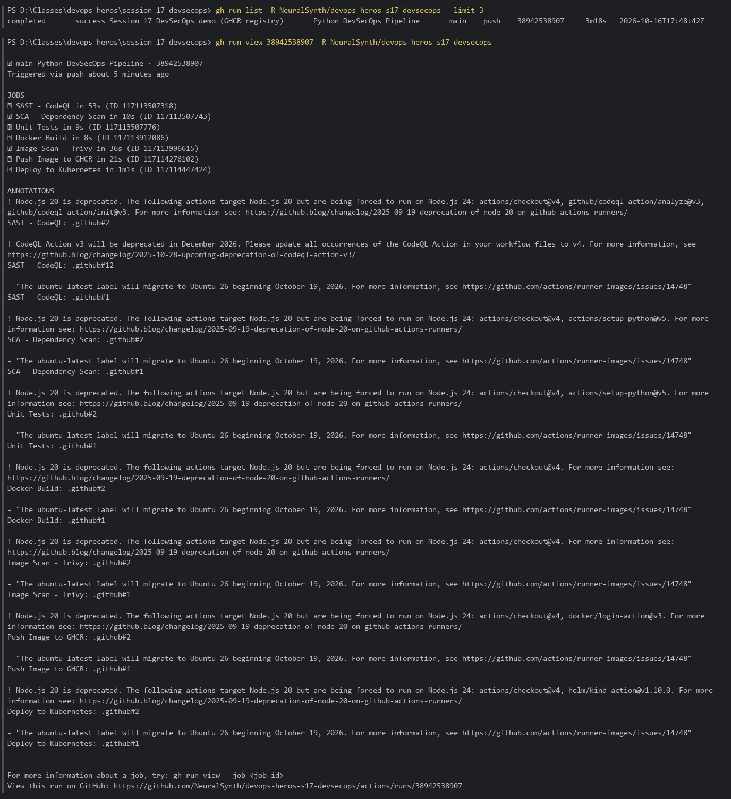
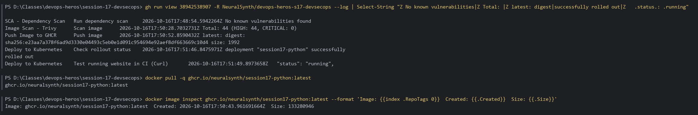

# Session 17: DevSecOps — Security in the CI/CD Pipeline

Hands-on verification of the DevSecOps pipeline in [`demo/.github/workflows/devsecops.yml`](../demo/.github/workflows/devsecops.yml), run **locally** stage by stage: unit tests → SAST → SCA → secret scanning → Docker build → image scan → run. Then the full pipeline on GitHub Actions: GHCR push and Kubernetes (kind) deploy.

**Environment:** Windows 11, PowerShell, Python 3.14, Docker 29.8, Docker Desktop Kubernetes. The scanners run from their official images (`zricethezav/gitleaks`, `aquasec/trivy`).

---

## Table of Contents

- [Pipeline Overview](#pipeline-overview)
- [Part 1 — Unit Tests & Coverage](#part-1--unit-tests--coverage)
- [Part 2 — SAST (Bandit)](#part-2--sast-bandit)
- [Part 3 — SCA (pip-audit)](#part-3--sca-pip-audit)
- [Part 4 — Secret Scanning (Gitleaks)](#part-4--secret-scanning-gitleaks)
- [Part 5 — Docker Build](#part-5--docker-build)
- [Part 6 — Container Image Scanning (Trivy)](#part-6--container-image-scanning-trivy)
- [Part 7 — Run the Container](#part-7--run-the-container)
- [Part 8 — GitHub Actions DevSecOps Pipeline: GHCR & Kubernetes](#part-8--github-actions-devsecops-pipeline-ghcr--kubernetes)
- [Findings Summary](#findings-summary)

---

## Pipeline Overview

```text
 push / PR → main
      │
      ├── Unit Tests (pytest + coverage)
      ├── SAST (CodeQL in CI · Bandit locally)
      └── SCA  (pip-audit)
              │  all must pass
              ▼
        Docker Build ──► Image Scan (Trivy HIGH/CRITICAL) ──► Push to GHCR ──► Deploy to Kubernetes
```

---

## Part 1 — Unit Tests & Coverage

```bash
cd session-17-devsecops\demo
python -m pytest --cov=app --cov-report=term-missing
```

**Result:** `8 passed`; coverage **69%** of `app/app.py` (the pipeline-simulator endpoint, lines 179–209, has no tests).



---

## Part 2 — SAST (Bandit)

CI uses **CodeQL**; locally the equivalent Python SAST tool is **Bandit**:

```bash
python -m bandit -r app/
```

**Result:** 7 issues, exit code 1, so this stage would **fail the gate**:

| Severity | Rule                                 | Location     | Meaning                                                                |
|:---------|:-------------------------------------|:-------------|:-----------------------------------------------------------------------|
| **High** | B201 `flask_debug_true`              | `app.py:234` | `debug=True` exposes the Werkzeug debugger → remote code execution     |
| Medium   | B104 `hardcoded_bind_all_interfaces` | `app.py:234` | Binds `0.0.0.0` (expected inside a container)                          |
| Low ×5   | B311 `random`                        | various      | `random` isn't cryptographically secure (only used for demo data here) |

**Fix for the High finding:** drive debug mode from the environment, e.g. `debug=os.getenv("FLASK_DEBUG") == "1"`.



---

## Part 3 — SCA (pip-audit)

```bash
python -m pip_audit -r requirements.txt
```

**Result:** `No known vulnerabilities found` for `Flask==3.1.3` and its dependency tree.



---

## Part 4 — Secret Scanning (Gitleaks)

```bash
docker run --rm -v ${PWD}:/repo zricethezav/gitleaks:latest dir /repo -v
```

**Result:** ~111 KB scanned, **no leaks found**.



---

## Part 5 — Docker Build

```bash
docker build -t session17-python:local .
docker images session17-python
```

**Result:** Image built from `python:3.12-slim`.



---

## Part 6 — Container Image Scanning (Trivy)

```bash
# Full HIGH/CRITICAL scan (summary table)
docker run --rm -v /var/run/docker.sock:/var/run/docker.sock -v trivy-cache:/root/.cache/ aquasec/trivy:latest image -q --severity HIGH,CRITICAL --table-mode summary session17-python:local

# Only vulnerabilities that already have a fix available
docker run --rm -v /var/run/docker.sock:/var/run/docker.sock -v trivy-cache:/root/.cache/ aquasec/trivy:latest image -q --severity HIGH,CRITICAL --ignore-unfixed session17-python:local
```

**Result:**
- OS layer (Debian 13.7): **44 HIGH, 0 CRITICAL**, mostly `util-linux` CVEs with status `affected` (no upstream fix yet).
- Python packages (Flask, Werkzeug, Jinja2, …): **0**.
- With `--ignore-unfixed`: **0**, so there is nothing actionable today. A gate using `--ignore-unfixed --exit-code 1` would pass; rebuilding on a newer base image picks up fixes as they ship.



---

## Part 7 — Run the Container

```bash
docker run -d -p 5001:5001 --name python-web session17-python:local
docker ps --filter name=python-web
curl.exe -s http://localhost:5001/health
curl.exe -s http://localhost:5001/api/status
docker logs python-web
```

**Result:** Container `Up`, `/health` returns `"status": "healthy"`, `/api/status` returns app/runtime info.



### Web Application in the Browser

<http://localhost:5001> serves the **DevSecOps Hub** dashboard (Status / Greet / Calc / Pipeline) with the health badge showing **Healthy**.



---

## Part 8 — GitHub Actions DevSecOps Pipeline: GHCR & Kubernetes

The `demo/` app was pushed to its own public repo so that `.github/workflows/devsecops.yml` sits at the repo root and runs on every push:

**Repo:** <https://github.com/NeuralSynth/devops-heros-s17-devsecops> · **Image:** `ghcr.io/neuralsynth/session17-python`

### Registry change: Docker Hub → GHCR

The original workflow pushed to a hardcoded Docker Hub account (`nensiravaliya28/hey-cicd`) using a `DOCKERHUB_TOKEN` secret. It now pushes to **GitHub Container Registry** using the built-in `GITHUB_TOKEN`, so no extra credentials are needed:

```yaml
push:
  permissions: { contents: read, packages: write }
  steps:
    - uses: docker/login-action@v3
      with:
        registry: ghcr.io
        username: ${{ github.actor }}
        password: ${{ secrets.GITHUB_TOKEN }}
    - run: docker push ghcr.io/neuralsynth/session17-python:${{ github.sha }}
```

`k8s/deployment.yaml` now uses `ghcr.io/neuralsynth/session17-python:__IMAGE_TAG__`. The deploy job gives its throwaway **kind** cluster an image-pull secret built from `GITHUB_TOKEN`, so it would work even if the package were private. GHCR names must be lowercase, hence `neuralsynth`.

### Pipeline run — all 7 jobs green

| Job | Result |
| :--- | :--- |
| Unit Tests | ✅ |
| SAST - CodeQL | ✅ |
| SCA - Dependency Scan (pip-audit) | ✅ No known vulnerabilities |
| Docker Build | ✅ |
| Image Scan - Trivy | ✅ report-only: 44 HIGH, 0 CRITICAL (OS packages, no fix yet) |
| Push Image to GHCR | ✅ `:<sha>` and `:latest` |
| Deploy to Kubernetes (kind) | ✅ rollout complete, `/api/status` → `"status": "running"` |




The published image is public (it inherits the public repo's visibility) and can be pulled anonymously with `docker pull ghcr.io/neuralsynth/session17-python:latest`.

---

## Findings Summary

| Stage      | Tool      | Result                                | Gate                       |
|:-----------|:----------|:--------------------------------------|:---------------------------|
| Unit tests | pytest    | 8/8 passed, 69% coverage              | ✅                         |
| SAST       | Bandit    | 1 High (Flask debug), 1 Medium, 5 Low | ❌ fix `debug=True`        |
| SCA        | pip-audit | 0 known vulnerabilities               | ✅                         |
| Secrets    | Gitleaks  | no leaks                              | ✅                         |
| Image scan | Trivy     | 44 HIGH (OS, unfixed) · 0 fixable     | ✅ with `--ignore-unfixed` |
