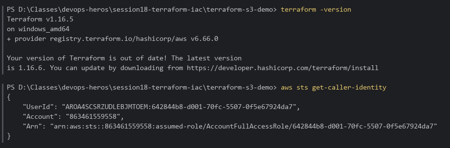
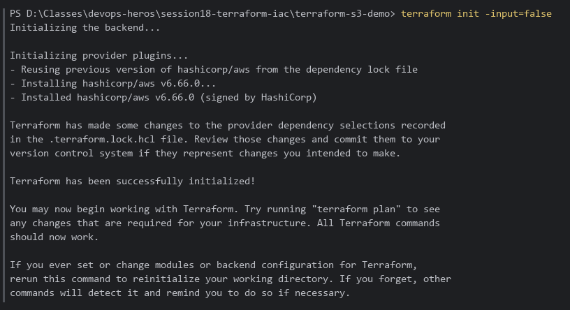
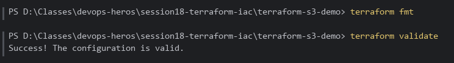
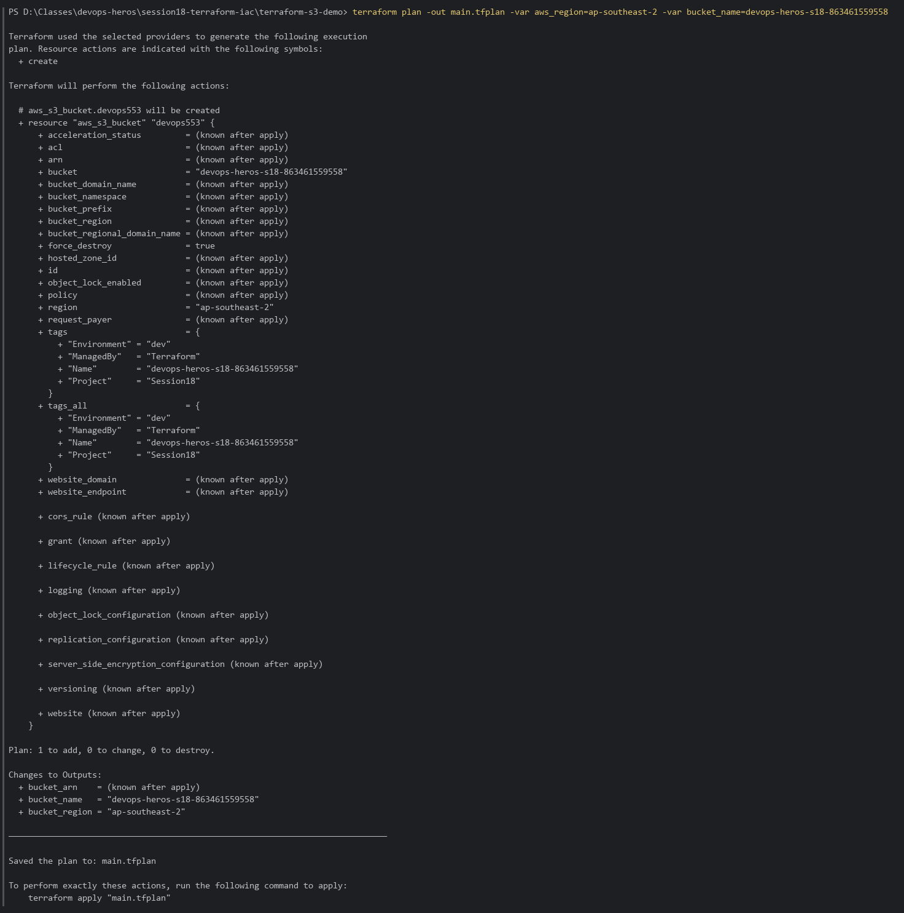
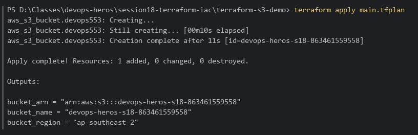
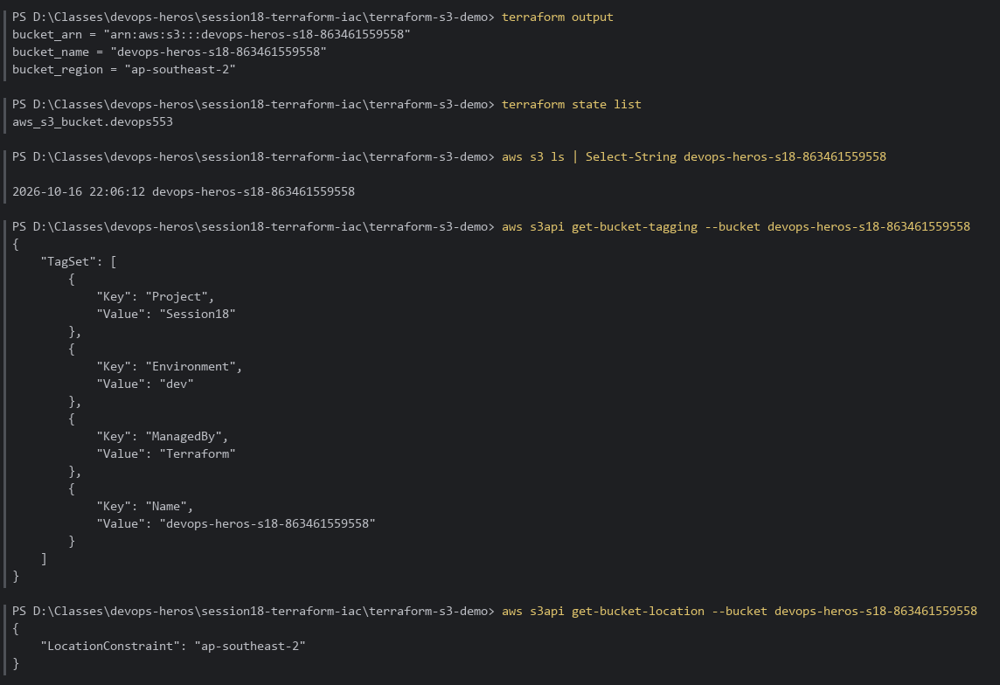
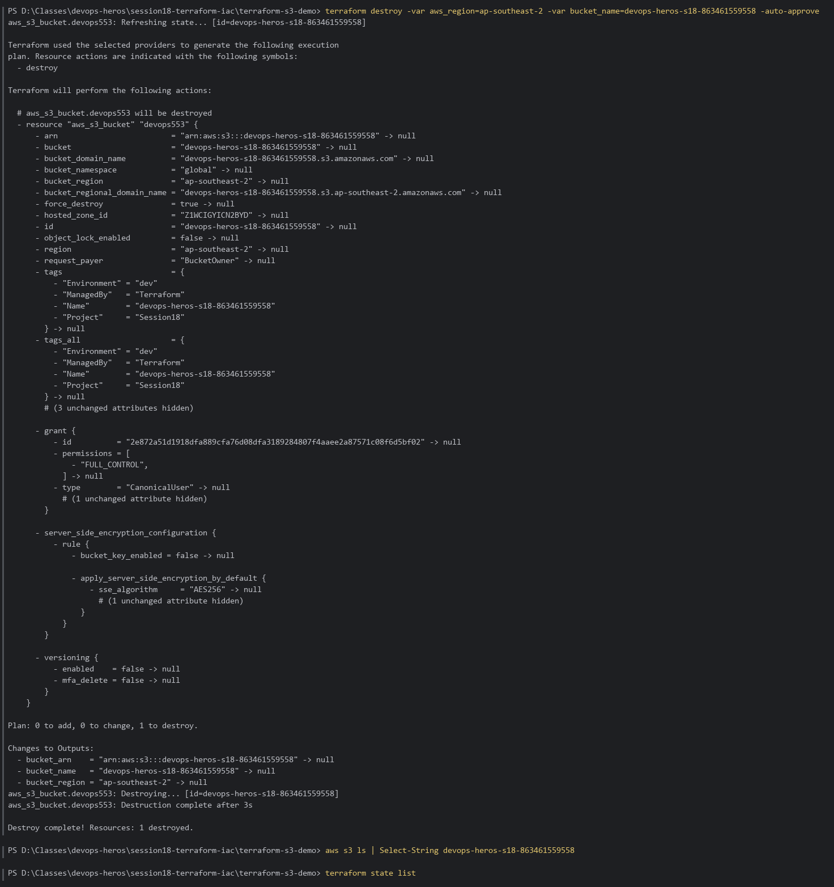

# Session 18: Terraform & Infrastructure as Code — S3 Bucket Provisioning

Hands-on verification of the full Terraform workflow (`init → fmt → validate → plan → apply → output → destroy`) using [`terraform-s3-demo`](../terraform-s3-demo) to provision a real Amazon S3 bucket.

**Environment:** Terraform **v1.16.5**, AWS provider **v6.66.0**, AWS CLI 2.38.1 (signed in with `aws login`), region **ap-southeast-2**, PowerShell.

---

## Table of Contents

- [Terraform Workflow](#terraform-workflow)
- [Part 1 — AWS Authentication & Terraform CLI](#part-1--aws-authentication--terraform-cli)
- [Part 2 — terraform init](#part-2--terraform-init)
- [Part 3 — terraform fmt & validate](#part-3--terraform-fmt--validate)
- [Part 4 — terraform plan](#part-4--terraform-plan)
- [Part 5 — terraform apply](#part-5--terraform-apply)
- [Part 6 — Outputs & AWS CLI Verification](#part-6--outputs--aws-cli-verification)
- [Part 7 — terraform destroy](#part-7--terraform-destroy)

---

## Terraform Workflow

```text
 write .tf ──► init ──► fmt / validate ──► plan -out ──► apply <plan> ──► output / state ──► destroy
               (providers)   (style / schema)   (preview diff)  (create exactly   (inspect)       (teardown)
                                                                 what was reviewed)
```

> **Variables used:** `aws_region=ap-southeast-2` (the account's region; the default in `variables.tf` is `ap-south-1`) and `bucket_name=devops-heros-s18-863461559558`. S3 bucket names are **globally unique**, so the default `yatri1107` is likely already taken. Adding the account ID makes the name unique.

---

## Part 1 — AWS Authentication & Terraform CLI

```bash
cd session18-terraform-iac\terraform-s3-demo
terraform -version
aws sts get-caller-identity
```

**Result:** Terraform v1.16.5 and an authenticated AWS identity (account `863461559558`), using short-lived credentials from `aws login` with no static access keys.



---

## Part 2 — terraform init

```bash
terraform init -input=false
```

**Result:** Backend initialized (local state) and the `hashicorp/aws ~> 6.0` provider installed (v6.66.0). The `.terraform.lock.hcl` gained the Windows checksum for that provider.



---

## Part 3 — terraform fmt & validate

```bash
terraform fmt
terraform validate
```

**Result:** Files are already canonically formatted; `Success! The configuration is valid.`



---

## Part 4 — terraform plan

```bash
terraform plan -out main.tfplan -var aws_region=ap-southeast-2 -var bucket_name=devops-heros-s18-863461559558
```

**Result:** `Plan: 1 to add, 0 to change, 0 to destroy.` creates `aws_s3_bucket.devops553` with tags `Environment=dev`, `ManagedBy=Terraform`, `Project=Session18`. The plan is saved to `main.tfplan` so `apply` runs exactly what was reviewed.



---

## Part 5 — terraform apply

```bash
terraform apply main.tfplan
```

**Result:** `Apply complete! Resources: 1 added, 0 changed, 0 destroyed.`



---

## Part 6 — Outputs & AWS CLI Verification

```bash
terraform output
terraform state list
aws s3 ls | Select-String devops-heros-s18-863461559558
aws s3api get-bucket-tagging --bucket devops-heros-s18-863461559558
aws s3api get-bucket-location --bucket devops-heros-s18-863461559558
```

**Result:**
- Outputs: `bucket_name`, `bucket_arn = arn:aws:s3:::devops-heros-s18-863461559558`, `bucket_region = ap-southeast-2`.
- State tracks `aws_s3_bucket.devops553`.
- AWS confirms the bucket exists, with the Terraform tags and `LocationConstraint: ap-southeast-2`.



---

## Part 7 — terraform destroy

```bash
terraform destroy -var aws_region=ap-southeast-2 -var bucket_name=devops-heros-s18-863461559558 -auto-approve
aws s3 ls | Select-String devops-heros-s18-863461559558
terraform state list
```

**Result:** `Destroy complete! Resources: 1 destroyed.` The bucket no longer appears in `aws s3 ls`, and the state is empty. Nothing is left running.



---

## Key Takeaways

- **Declarative:** describe the desired end state; Terraform computes the diff.
- **`plan -out` + `apply <planfile>`** guarantees that what you reviewed is what gets applied.
- **State** (`terraform.tfstate`) maps code to real resources. It's git-ignored and must never be committed.
- **`force_destroy = true`** lets `destroy` remove the bucket even if it has objects. That's convenient for labs and dangerous in production.
