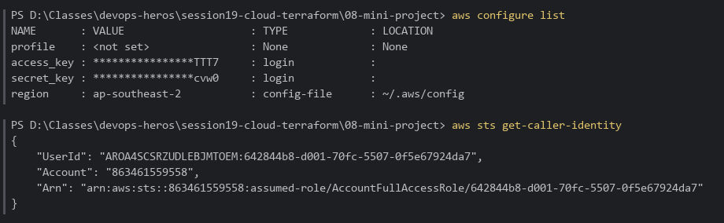
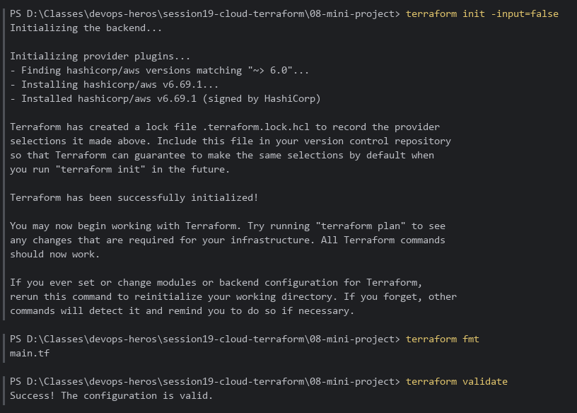
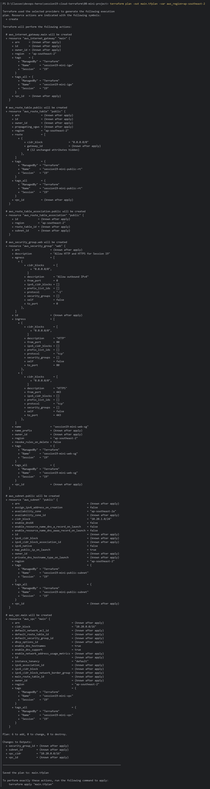
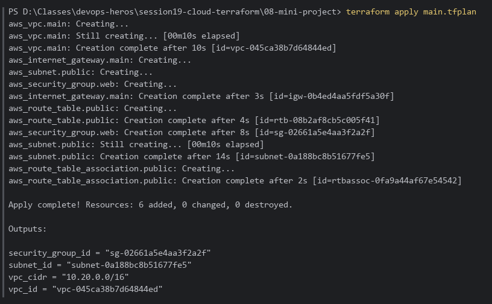
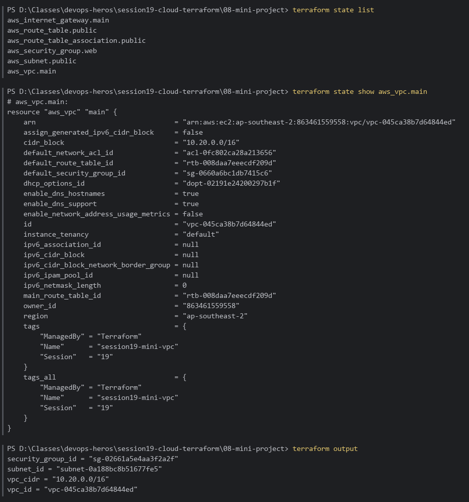
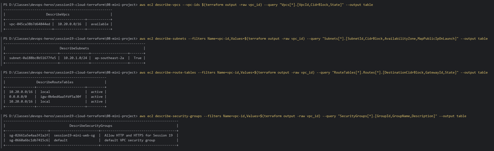
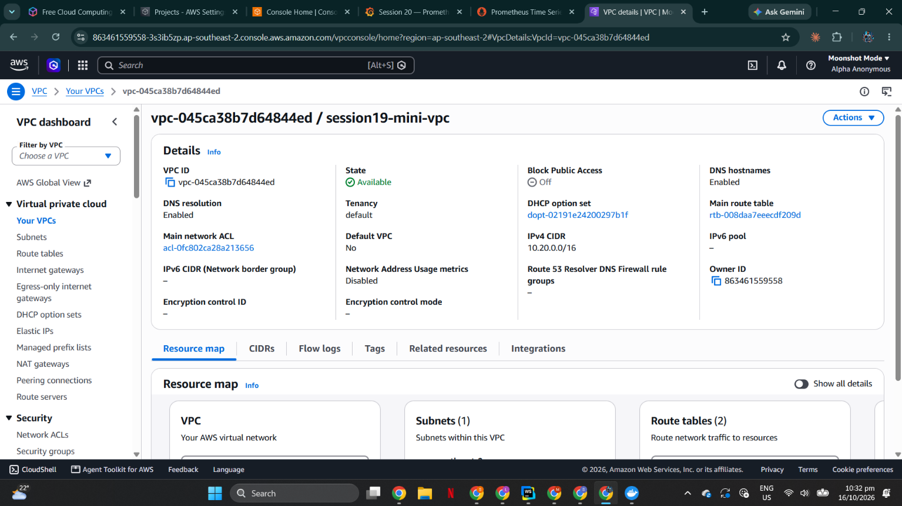
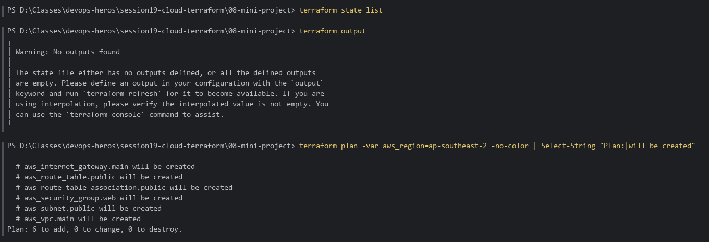

# Session 19: Cloud Architecture & Terraform in Action — VPC Deployment

Hands-on verification of the [`08-mini-project`](../08-mini-project) VPC: a public network with a VPC, public subnet, Internet Gateway, route table + association, and a web security group, provisioned on AWS with Terraform.

**Environment:** Terraform **v1.16.5**, AWS provider v6, AWS CLI 2.38.1 (signed in with `aws login`), region **ap-southeast-2**, PowerShell.

---

## Table of Contents

- [Architecture](#architecture)
- [Part 1 — AWS Profile & Identity](#part-1--aws-profile--identity)
- [Part 2 — init, fmt & validate](#part-2--init-fmt--validate)
- [Part 3 — terraform plan (6 resources)](#part-3--terraform-plan-6-resources)
- [Part 4 — terraform apply](#part-4--terraform-apply)
- [Part 5 — State Inventory](#part-5--state-inventory)
- [Part 6 — AWS CLI Verification](#part-6--aws-cli-verification)
- [Part 7 — AWS Console & Destroy](#part-7--aws-console--destroy)

---

## Architecture

```text
                     Internet
                        │
              ┌─────────┴─────────┐
              │ Internet Gateway  │  session19-mini-igw
              └─────────┬─────────┘
   VPC 10.20.0.0/16     │            session19-mini-vpc
  ┌─────────────────────┼──────────────────────────────┐
  │  Route table: 0.0.0.0/0 → IGW, 10.20.0.0/16 → local │
  │                     │                              │
  │  ┌──────────────────┴─────────────┐                │
  │  │ Public subnet 10.20.1.0/24     │ ap-southeast-2a│
  │  │ map_public_ip_on_launch = true │                │
  │  │  SG session19-mini-web-sg:     │                │
  │  │   in  80/tcp, 443/tcp          │                │
  │  │   out all                      │                │
  │  └────────────────────────────────┘                │
  └────────────────────────────────────────────────────┘
```

> Applied with `-var aws_region=ap-southeast-2` (the account's region). The default in `variables.tf` is `ap-south-1`.

---

## Part 1 — AWS Profile & Identity

```bash
cd session19-cloud-terraform\08-mini-project
aws configure list
aws sts get-caller-identity
```

**Result:** The `default` profile in region `ap-southeast-2`, using short-lived `aws login` credentials; the identity is account `863461559558`.



---

## Part 2 — init, fmt & validate

```bash
terraform init -input=false
terraform fmt
terraform validate
```

**Result:** Provider installed and lock file created; `terraform fmt` re-aligned one line in `main.tf`; `Success! The configuration is valid.`



---

## Part 3 — terraform plan (6 resources)

```bash
terraform plan -out main.tfplan -var aws_region=ap-southeast-2
```

**Result:** `Plan: 6 to add, 0 to change, 0 to destroy.` The six resources are `aws_vpc.main`, `aws_subnet.public`, `aws_internet_gateway.main`, `aws_route_table.public`, `aws_route_table_association.public`, and `aws_security_group.web`.



---

## Part 4 — terraform apply

```bash
terraform apply main.tfplan
```

**Result:** `Apply complete! Resources: 6 added, 0 changed, 0 destroyed.` Terraform orders creation by dependency: VPC → IGW/subnet/SG → route table → association.



---

## Part 5 — State Inventory

```bash
terraform state list
terraform state show aws_vpc.main
terraform output
```

**Result:** All 6 resources tracked in state; `aws_vpc.main` shows `cidr_block = 10.20.0.0/16`, DNS support/hostnames enabled, and tags; outputs `vpc_id`, `vpc_cidr`, `subnet_id`, `security_group_id`.



---

## Part 6 — AWS CLI Verification

Confirms in AWS itself, not only in Terraform state:

```bash
aws ec2 describe-vpcs --vpc-ids $(terraform output -raw vpc_id) --query "Vpcs[*].[VpcId,CidrBlock,State]" --output table
aws ec2 describe-subnets --filters Name=vpc-id,Values=$(terraform output -raw vpc_id) --query "Subnets[*].[SubnetId,CidrBlock,AvailabilityZone,MapPublicIpOnLaunch]" --output table
aws ec2 describe-route-tables --filters Name=vpc-id,Values=$(terraform output -raw vpc_id) --query "RouteTables[*].Routes[*].[DestinationCidrBlock,GatewayId,State]" --output table
aws ec2 describe-security-groups --filters Name=vpc-id,Values=$(terraform output -raw vpc_id) --query "SecurityGroups[*].[GroupId,GroupName,Description]" --output table
```

**Result:**

| Resource        | Value                                                                                     |
|:----------------|:------------------------------------------------------------------------------------------|
| VPC             | `vpc-045ca38b7d64844ed`, `10.20.0.0/16`, `available`                                      |
| Subnet          | `subnet-0a188bc8b51677fe5`, `10.20.1.0/24`, `ap-southeast-2a`, public IP on launch `True` |
| Routes          | `10.20.0.0/16 → local`, `0.0.0.0/0 → igw-0b4ed4aa5fdf5a30f` (active)                      |
| Security groups | `session19-mini-web-sg` (+ the VPC's automatic `default` SG)                              |



---

## Part 7 — AWS Console & Destroy

### AWS Management Console

VPC console (region *Asia Pacific (Sydney) ap-southeast-2*) → *Your VPCs* → `session19-mini-vpc`. It shows `vpc-045ca38b7d64844ed`, state **Available**, IPv4 CIDR `10.20.0.0/16`, DNS resolution/hostnames enabled, owner `863461559558`, and the Resource map with 1 subnet and 2 route tables (main + public).



### terraform destroy

```powershell
cd session19-cloud-terraform\08-mini-project
terraform destroy -var aws_region=ap-southeast-2     # confirm with: yes
terraform state list                                   # empty
terraform output                                       # "No outputs found"
terraform plan -var aws_region=ap-southeast-2 -no-color | Select-String "Plan:|will be created"
```

**Result:** All 6 resources destroyed. State is empty, there are no outputs, and a fresh `plan` wants to create all 6 again (`Plan: 6 to add`), which proves nothing is left in AWS. An independent EC2 API check in ap-southeast-2 also found no remaining VPC, subnet, IGW, route table or `session19-mini-web-sg`.



---

## Key Takeaways

- **Public subnet** = a subnet whose route table sends `0.0.0.0/0` to an **Internet Gateway**.
- **Security groups** are stateful: allowing inbound 80/443 automatically permits the replies.
- Terraform builds the **dependency graph** from references (`aws_vpc.main.id`), so creation and destruction happen in the right order without you specifying it.
