# Session 20: Monitoring, Observability & GitOps

Verification of the three pillars of observability, Prometheus metrics and PromQL, a Prometheus + Grafana stack, and GitOps with Argo CD.

**Environment:** Docker Desktop Kubernetes (`docker-desktop`, v1.36) with metrics-server, Docker Compose, PowerShell. Images: `prom/prometheus:v3.5.0`, `grafana/grafana:12.1.1`, Argo CD `stable`.

---

## Table of Contents

- [Part 1 — Metrics & Logs from a Kubernetes Workload](#part-1--metrics--logs-from-a-kubernetes-workload)
- [Part 2 — Prometheus & PromQL Queries](#part-2--prometheus--promql-queries)
- [Part 3 — Prometheus + Grafana Stack](#part-3--prometheus--grafana-stack)
- [Part 4 — Argo CD Installation](#part-4--argo-cd-installation)
- [Part 5 — GitOps with Argo CD](#part-5--gitops-with-argo-cd)
- [Part 6 — Mini-Project: session20-mini](#part-6--mini-project-session20-mini)

---

## Part 1 — Metrics & Logs from a Kubernetes Workload

```bash
cd session20-monitoring-observability-gitops\02-metrics-logs-traces\k8s-demo
kubectl apply -f deployment.yaml -f service.yaml
kubectl rollout status deployment/session20-demo
kubectl get pods -l app=session20-demo
kubectl logs deployment/session20-demo --tail=8      # LOGS: what happened
kubectl top pods -l app=session20-demo               # METRICS: how much (CPU / memory)
```

**Result:** The Pod runs and emits structured log lines (`Request received`, `Health check OK`). `kubectl top` reports live resource metrics from metrics-server. **Traces**, the third pillar, need request-level instrumentation such as OpenTelemetry, which this demo app doesn't have.

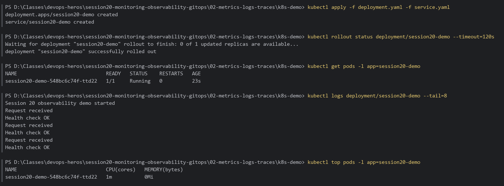

---

## Part 2 — Prometheus & PromQL Queries

```bash
cd session20-monitoring-observability-gitops\03-prometheus
docker compose up -d
docker compose ps
curl.exe -s http://localhost:9090/-/ready

# Scrape targets
(Invoke-RestMethod 'http://localhost:9090/api/v1/targets').data.activeTargets | Select-Object scrapeUrl, health, lastScrapeDuration | Format-Table -AutoSize

# PromQL via the HTTP API
up
prometheus_tsdb_head_series
sum by (handler) (rate(prometheus_http_requests_total[1m])) > 0

docker compose down
```

**Result:**
- Target `http://prometheus:9090/metrics` is `up` (Prometheus scrapes itself every 5s, per `prometheus.yml`).
- `up{job="prometheus"} = 1`
- `prometheus_tsdb_head_series = 573` active time series.
- `rate(...)` shows the `/metrics` handler being hit ~0.13 req/s (once every ~5s by the scraper), which matches the scrape interval.

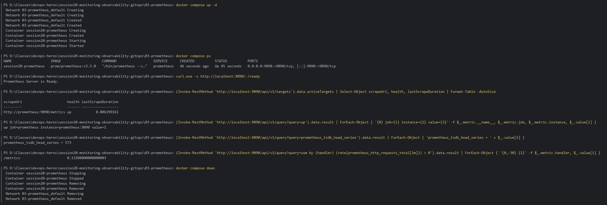

---

## Part 3 — Prometheus + Grafana Stack

```bash
cd session20-monitoring-observability-gitops\04-grafana
docker compose up -d
docker compose ps
curl.exe -s http://localhost:3000/api/health
curl.exe -s http://localhost:9090/-/ready
```

**Result:** `session20-prometheus` (9090) and `session20-grafana` (3000) are up; Grafana health shows `"database": "ok"`, `version 12.1.1`.

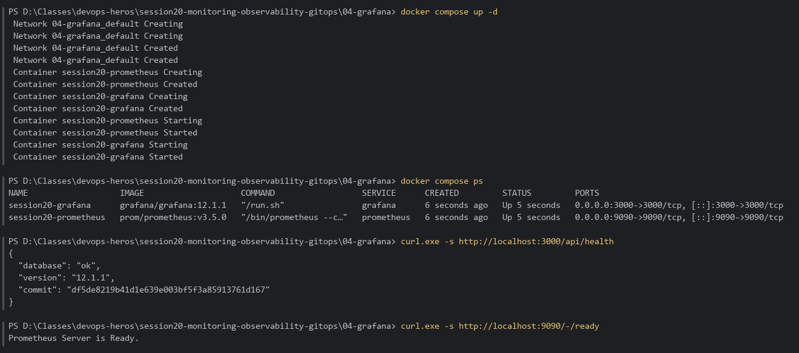

### Grafana data source & dashboard (provisioned)

The Prometheus data source and a dashboard were added through **Grafana provisioning**: YAML/JSON files copied into the running container's `/etc/grafana/provisioning/`, which Grafana loads at startup.

```yaml
# /etc/grafana/provisioning/datasources/prometheus.yaml
apiVersion: 1
datasources:
  - name: Prometheus
    uid: session20-prom
    type: prometheus
    access: proxy
    url: http://prometheus:9090   # Compose service name, not localhost
    isDefault: true
```

Dashboard **Session 20 — Prometheus Monitoring** (folder *Session 20*, refreshes every 5s):

| Panel                        | PromQL                                                            |
|:-----------------------------|:------------------------------------------------------------------|
| Target Up                    | `up{job="prometheus"}`                                            |
| Active Time Series           | `prometheus_tsdb_head_series`                                     |
| Uptime                       | `time() - process_start_time_seconds`                             |
| Memory (RSS)                 | `process_resident_memory_bytes`                                   |
| HTTP Request Rate by Handler | `sum by (handler) (rate(prometheus_http_requests_total[1m])) > 0` |
| Scrape Duration              | `scrape_duration_seconds`                                         |
| Samples Ingested / s         | `rate(prometheus_tsdb_head_samples_appended_total[1m])`           |
| CPU Usage                    | `rate(process_cpu_seconds_total[1m])`                             |

**Result:** Live dashboard (last 15 min, 5s refresh). Target **Up = 1**, **758** active series, uptime ~11 min, ~108 MiB RSS. The request rate is dominated by the `/metrics` scrape (~0.2 req/s), with scrape duration mostly under 5 ms and ~150 samples/s ingested.

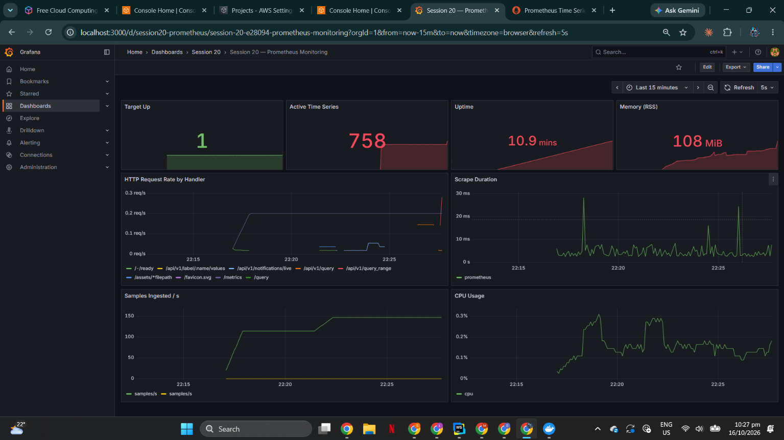

### Prometheus UI

The same PromQL from Part 2, run in the Prometheus web UI (`/query`): `up` returns `up{instance="prometheus:9090", job="prometheus"} = 1`.

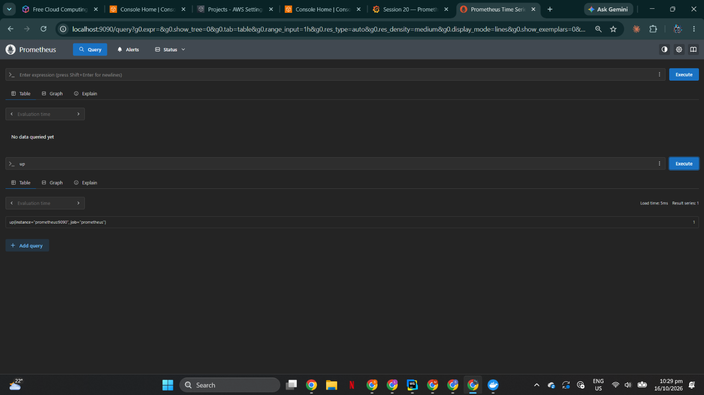

> If `localhost` shows a different app in the browser, use `http://127.0.0.1:3000` / `:9090`. A WSL app is relayed on `[::1]` for the same ports.

---

## Part 4 — Argo CD Installation

```bash
cd session20-monitoring-observability-gitops\07-argocd
kubectl create namespace argocd
kubectl apply -n argocd --server-side --force-conflicts -f https://raw.githubusercontent.com/argoproj/argo-cd/stable/manifests/install.yaml
kubectl wait --for=condition=Ready pods --all -n argocd --timeout=420s
kubectl get pods -n argocd
kubectl get svc -n argocd argocd-server
```

> `--server-side` is needed because the Argo CD CRDs are too large for the `last-applied-configuration` annotation used by client-side apply.

**Result:** All 7 Argo CD components are `1/1 Running`: application-controller, applicationset-controller, dex-server, notifications-controller, redis, repo-server, and server.

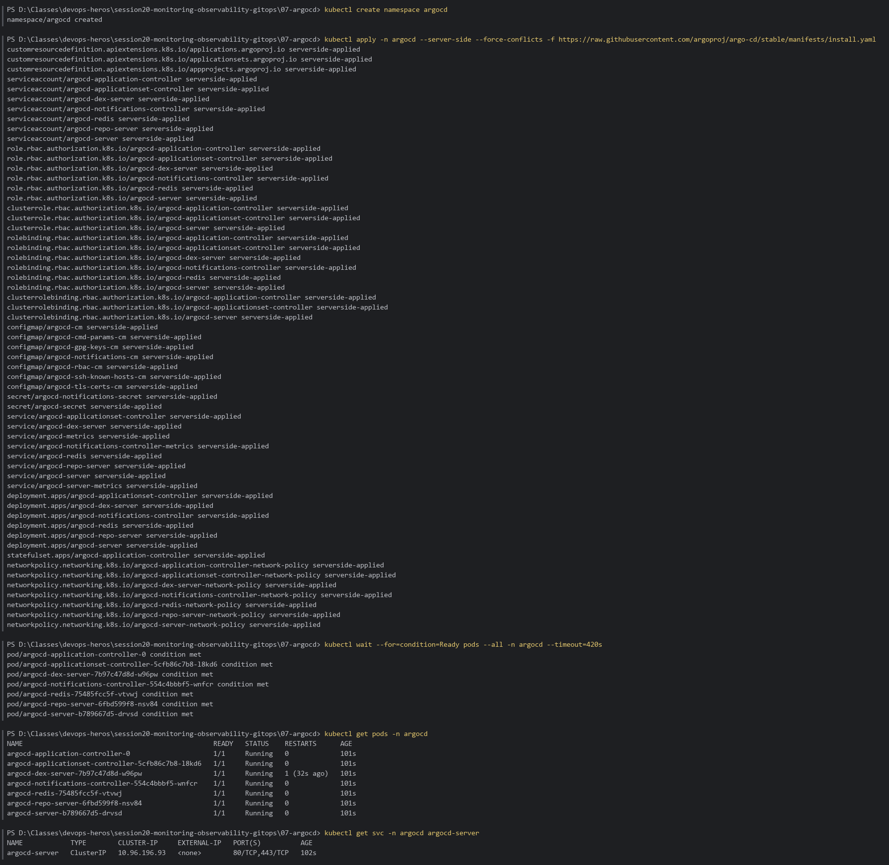

---

## Part 5 — GitOps with Argo CD

**GitOps source repo:** <https://github.com/NeuralSynth/devops-heros-s20-gitops> (local clone `D:\Classes\devops-heros-s20-gitops`)

| Path | Argo CD Application | Manifest in this repo |
| :--- | :--- | :--- |
| `app/` | `session20-app` | [`07-argocd/app/argocd-application.yaml`](../07-argocd/app/argocd-application.yaml) |
| `mini/` | `session20-mini` | [`08-mini-project/app/argocd-application.yaml`](../08-mini-project/app/argocd-application.yaml) |

Both Applications use `syncPolicy.automated` with `prune: true` and `selfHeal: true`. Their `repoURL` was changed from the instructor's / placeholder repo to the repo above. The GitOps repo starts at **2 replicas** so the Git change is visible.

### Stage 1 — Register the application (2 replicas)

```powershell
kubectl apply -f 07-argocd/app/argocd-application.yaml
kubectl get applications -n argocd
kubectl get pods -n session20 -l app=session20-gitops-app
```

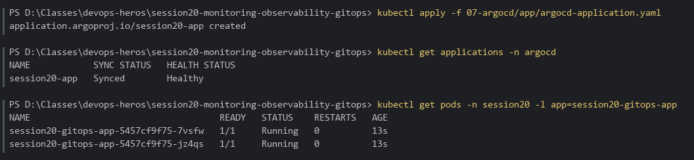

### Stage 2 — Change Git, not the cluster (2 → 5)

```powershell
cd D:\Classes\devops-heros-s20-gitops
(Get-Content app/deployment.yaml) -replace 'replicas: 2', 'replicas: 5' | Set-Content app/deployment.yaml
git add app/deployment.yaml
git commit -m "Scale session20-app from 2 to 5 replicas"
git push

# Argo CD polls Git every ~3 min; ask for an immediate refresh instead of waiting
kubectl annotate application session20-app -n argocd argocd.argoproj.io/refresh=normal --overwrite
```

**Result:** Argo CD syncs the pushed commit (`REVISION 3209a85…`, the same SHA as the `git push`), and the Deployment scales to **5/5** with no `kubectl apply`.

> The GitOps repo's history was later rewritten to edit commit messages only (no file changes), so on GitHub this commit is now `a0c92ce` (was `3209a85`) and the repo head is `fe5e95b` (was `5176929`). Argo CD re-synced to the new head with no change to the cluster.

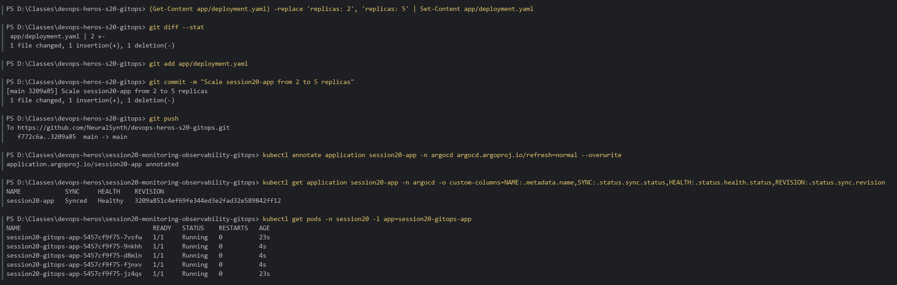

### Stage 3 — Self-healing

```powershell
kubectl scale deployment session20-gitops-app -n session20 --replicas=1   # manual drift
kubectl get deployment session20-gitops-app -n session20                   # 1/1 ...
kubectl get deployment session20-gitops-app -n session20                   # ... back to 5/5
```

**Result:** `selfHeal: true` detects the drift from Git and restores **5/5** within seconds; the sync history grows (`0,1,2`).

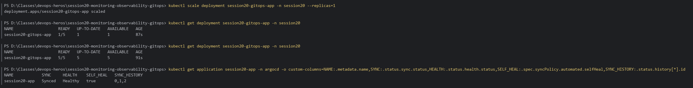

### Argo CD dashboard

```powershell
kubectl port-forward svc/argocd-server -n argocd 8443:443   # → https://localhost:8443  (8080 is used by a local Apache)
```

Both applications are **Healthy / Synced**, tracking `main` of the GitOps repo (`app` and `mini` paths, namespace `session20`).

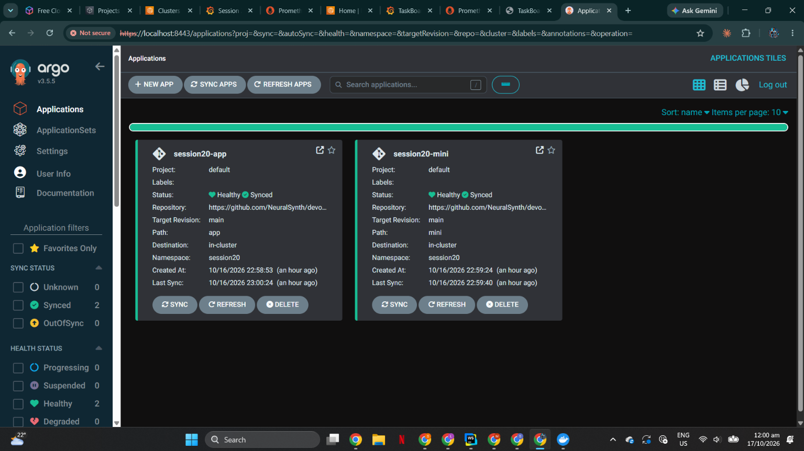

---

## Part 6 — Mini-Project: session20-mini

```powershell
kubectl apply -f 08-mini-project/app/argocd-application.yaml
kubectl get applications -n argocd
kubectl get all -n session20 -l app=session20-mini

# Git change 2 → 3 in the GitOps repo
(Get-Content mini/deployment.yaml) -replace 'replicas: 2', 'replicas: 3' | Set-Content mini/deployment.yaml
git add mini/deployment.yaml; git commit -m "Scale application to three replicas"; git push
kubectl annotate application session20-mini -n argocd argocd.argoproj.io/refresh=normal --overwrite

# Self-healing
kubectl scale deployment session20-mini -n session20 --replicas=1
kubectl get deployment session20-mini -n session20      # back to 3/3
kubectl logs deployment/session20-mini -n session20 --tail=5
kubectl get application session20-mini -n argocd
```

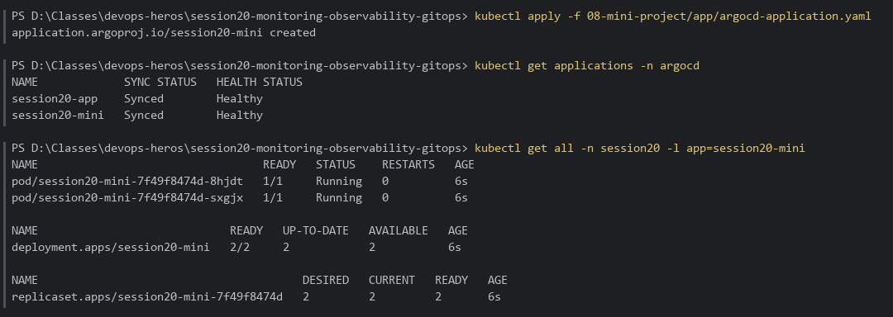
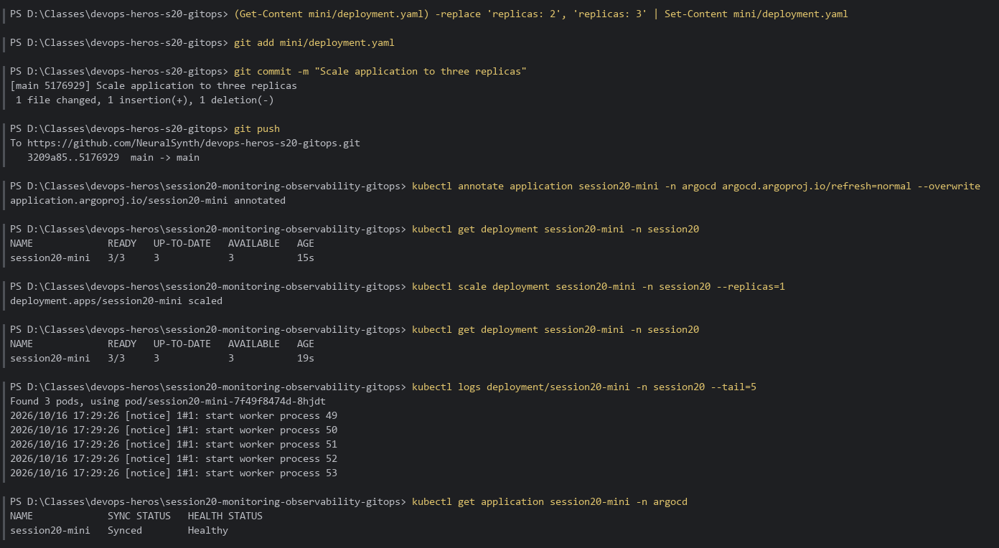

### Viva notes

- **Git is the source of truth:** the cluster changed only because Git changed; manual edits are reverted.
- **Pull model:** Argo CD runs inside the cluster and *pulls* from Git. CI never needs cluster credentials.
- **Audit and rollback:** every change is a commit; reverting a commit rolls the cluster back.

---

## Cleanup

```bash
cd session20-monitoring-observability-gitops\04-grafana; docker compose down
kubectl delete -f ..\07-argocd\app\argocd-application.yaml
kubectl delete namespace argocd session20
```
