# Session 21 — DevOps Final Capstone: LiftLog Workout Tracker

**LiftLog** is a strength-training tracker with "premium" analytics: personal records, estimated one-rep max, volume by muscle group and progress charts. It's built and delivered with the full DevOps toolchain:

```text
pytest → Docker (non-root) → GitHub Actions → Trivy gate → GHCR (:sha) → GitOps commit → Argo CD → EKS (Helm, ALB Ingress, HPA) → Prometheus + Grafana
                                                                                         ▲
                                                                     Terraform: VPC + EKS on AWS
```

| | |
| :--- | :--- |
| **Repository** | <https://github.com/NeuralSynth/devops-heros-s21-liftlog> |
| **Green pipeline** | <https://github.com/NeuralSynth/devops-heros-s21-liftlog/actions/runs/38958529088> |
| **Images** | `ghcr.io/neuralsynth/liftlog-backend`, `ghcr.io/neuralsynth/liftlog-frontend` (tagged with the commit SHA) |
| **Cloud** | AWS project `863461559558`, region **ap-southeast-2**, EKS **1.36**, 2 × `m7i-flex.large` |
| **Project README** | [`../README.md`](../README.md): features, API, local run, CI/CD, EKS deployment |

The rubric is in [`GRADING.md`](../GRADING.md); each section below maps to one module. The starter TaskBoard project was replaced by an original application domain, as `GRADING.md` requires.

---

## Table of Contents

- [M1 — Application](#m1--application)
- [M2 — Testing](#m2--testing)
- [M3 — Git and GitHub](#m3--git-and-github)
- [M4 — Docker](#m4--docker)
- [M5 — CI/CD](#m5--cicd)
- [M6 — DevSecOps: Trivy](#m6--devsecops-trivy)
- [M7 — Terraform](#m7--terraform)
- [M8 — Kubernetes + Helm](#m8--kubernetes--helm)
- [M9 — Observability](#m9--observability)
- [M10 — Live demo: commit → pipeline → deployment](#m10--live-demo-commit--pipeline--deployment)
- [Engineering notes](#engineering-notes)
- [Submission checklist](#submission-checklist)

---

## M1 — Application

| Requirement | Where |
| :--- | :--- |
| FastAPI backend, `/health` | [`backend/app/main.py`](../backend/app/main.py): `/health`, `/ready` (checks the DB), `/metrics` |
| ≥ 4 REST endpoints (GET/POST/PUT/DELETE) | 11 endpoints: CRUD for `/api/exercises` and `/api/workouts` (with nested sets), `/api/exercises/{id}/progress`, `/api/stats` |
| PostgreSQL table(s) via Alembic | [`0001_create_liftlog_schema.py`](../backend/alembic/versions/0001_create_liftlog_schema.py): `exercises`, `workouts`, `workout_sets`, plus 21 seeded exercises |
| Frontend renders and calls the API | [`frontend/src/main.jsx`](../frontend/src/main.jsx): Dashboard, Log workout, History, Exercises, Progress |

Data model: **Exercise** (name, muscle group, equipment) ← **WorkoutSet** (reps, weight kg, RPE, position) → **Workout** (title, date, duration, notes). Analytics use the Epley estimate `1RM = weight × (1 + reps/30)`.

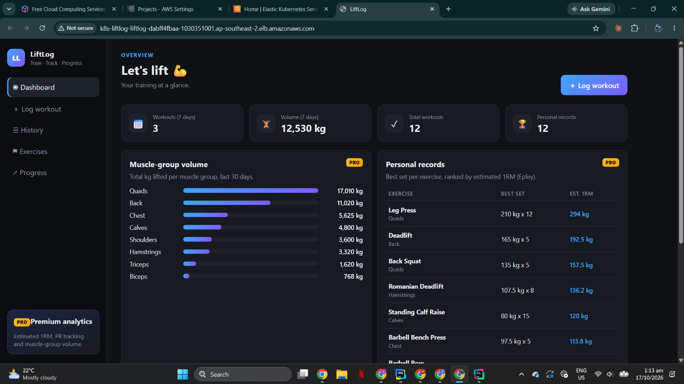

---

## M2 — Testing

[`backend/tests/test_api.py`](../backend/tests/test_api.py): **14 tests** on a throwaway SQLite database (deleted before each run, never Postgres). They cover the service endpoints, exercise CRUD, validation and duplicates, workouts with nested sets (create, update, delete), the delete guard for exercises that are in use, 404s, the Epley maths, PRs and progress, and weekly/muscle-group stats. Configuration is in [`backend/pytest.ini`](../backend/pytest.ini).

```powershell
cd session21-python\backend
docker run --rm -v ${PWD}:/src:ro python:3.12-slim sh -c "cp -r /src /app && cd /app && pip install -q -r requirements.txt && python -m pytest -v"
```

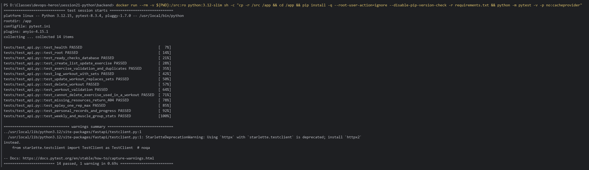

---

## M3 — Git and GitHub

- Public repo: <https://github.com/NeuralSynth/devops-heros-s21-liftlog>, with **19 commits**, each describing its change. `github-actions[bot]` commits are the GitOps deploys.
- [`.gitignore`](../.gitignore) excludes `.env`, `__pycache__/`, `node_modules/`, `.venv/`, `venv/`, Terraform state and `*.tfvars`.

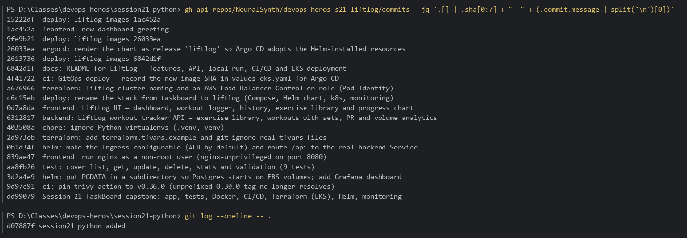

---

## M4 — Docker

| Requirement | Evidence |
| :--- | :--- |
| `backend/Dockerfile` builds | `python:3.12-slim`; runs `alembic upgrade head`, then uvicorn |
| Frontend multi-stage build | `node:22-alpine` build stage → `nginxinc/nginx-unprivileged:1.31.7-alpine` runtime |
| Non-root images | backend `uid=10001(appuser)`, frontend `uid=101(nginx)` (shown with `docker compose exec … id`) |
| `docker compose up --build` | Postgres has a healthcheck; the backend waits for `service_healthy` and restarts on failure |

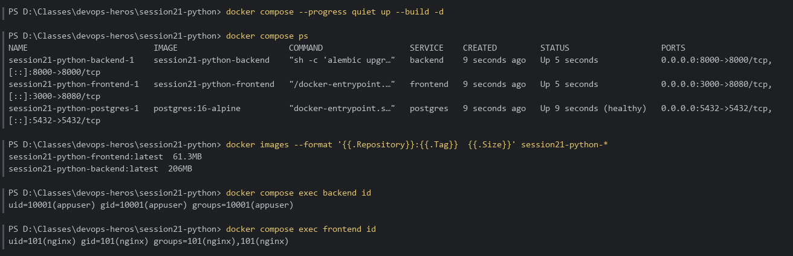
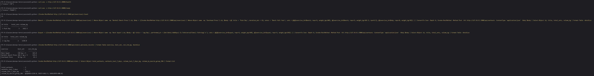

---

## M5 — CI/CD

[`.github/workflows/ci-cd.yml`](../.github/workflows/ci-cd.yml) runs on push and PR to `main`:

| Job | What it does |
| :--- | :--- |
| `test` | `pytest` (fails the build on any failure) + frontend `npm run build` |
| `build-scan-push` | builds backend and frontend images → Trivy gate → pushes `:<commit-sha>` and `:latest` to GHCR (lowercased owner) |
| `update-gitops` | commits the new SHA into `helm/liftlog/values-eks.yaml` → Argo CD deploys it (see M10) |

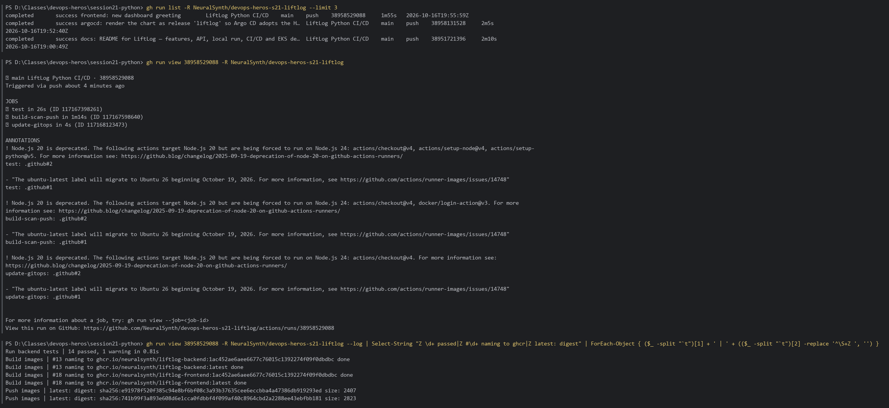
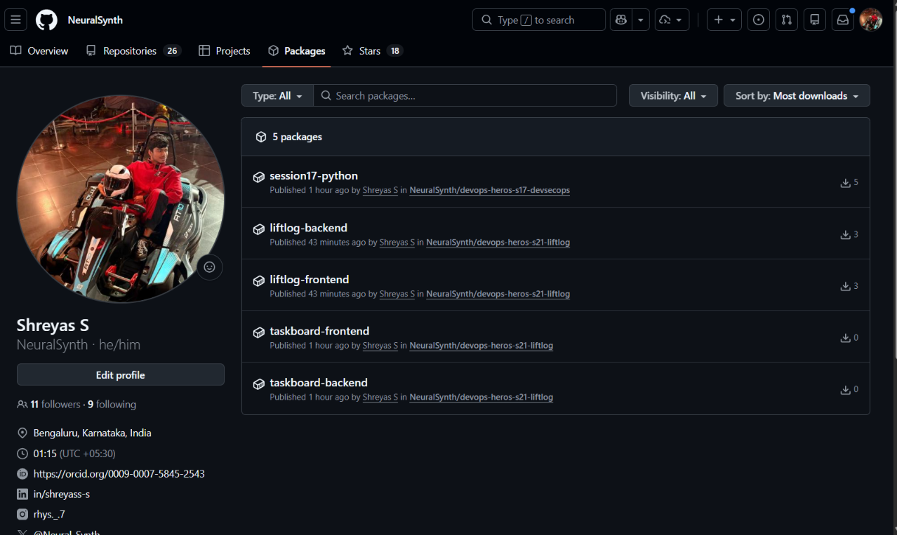

> The `taskboard-*` packages on the GHCR page are left over from before the rename to LiftLog.

---

## M6 — DevSecOps: Trivy

Gate: `aquasecurity/trivy-action@v0.36.0`, `severity: HIGH,CRITICAL`, `ignore-unfixed: true`, `exit-code: '1'`, run on **both** images before anything is pushed.

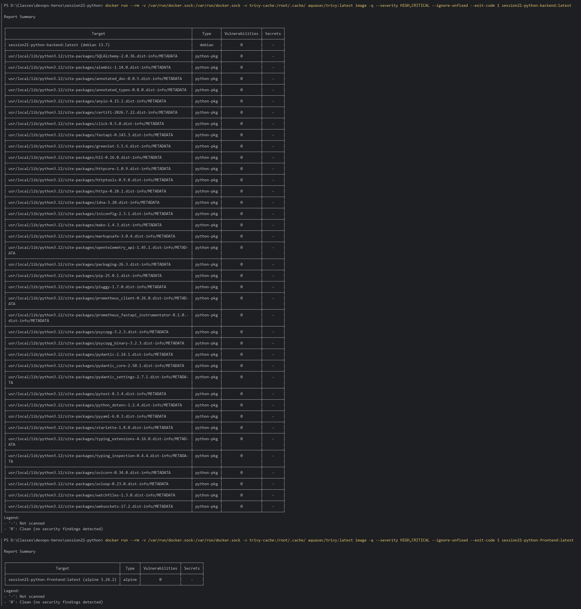
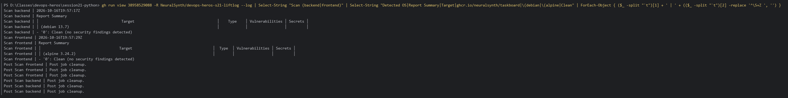

**What Trivy scanned and what the result means:** Trivy scanned both images: the OS packages of the base images (Debian 13.7 for the backend, Alpine for the nginx frontend) and the Python packages in the backend. With the starter versions the gate failed: 3 fixable HIGH CVEs in `starlette 0.41.3` and 43 fixable HIGH/CRITICAL CVEs in the old `nginx:1.27-alpine` base (OpenSSL, expat, libpng, …). After upgrading FastAPI/starlette and moving to a current, non-root nginx base, both images report **0 fixable HIGH/CRITICAL vulnerabilities**, so the pipeline publishes them.

---

## M7 — Terraform

[`terraform/`](../terraform): VPC module 6.7.3 (**2 public + 2 private subnets** in ap-southeast-2a/b, IGW, single NAT gateway) and EKS module 21.29.0 (Kubernetes 1.36, managed node group 2 × `m7i-flex.large`, add-ons vpc-cni, kube-proxy, coredns, pod-identity-agent, metrics-server and aws-ebs-csi-driver). The EBS CSI driver and the AWS Load Balancer Controller get IAM roles through **EKS Pod Identity**. [`terraform.tfvars.example`](../terraform/terraform.tfvars.example) is committed; real `*.tfvars` are git-ignored, and no credentials are in the repo (auth is `aws login`).

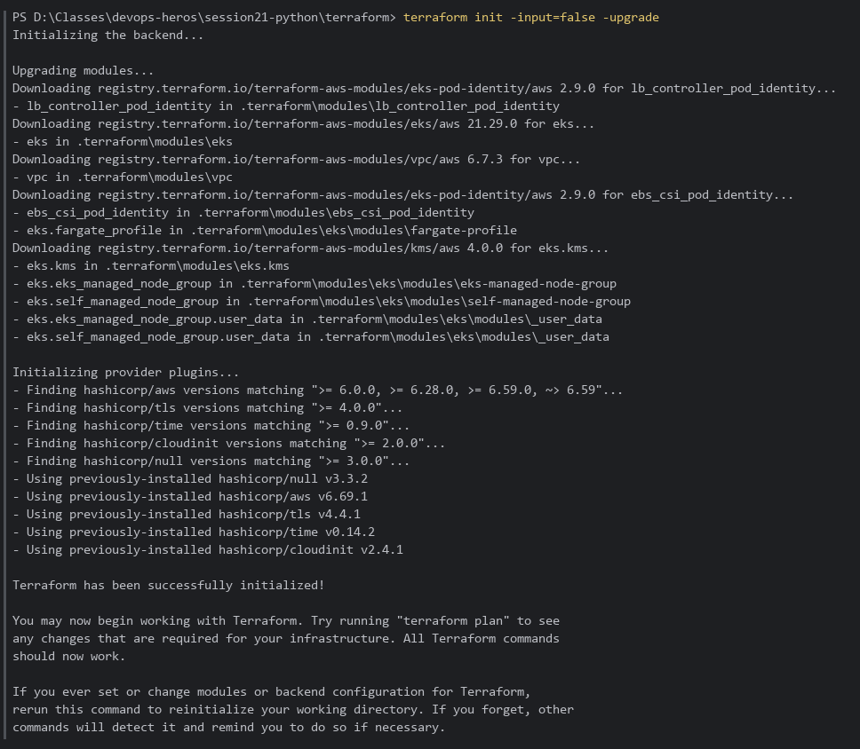
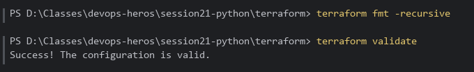
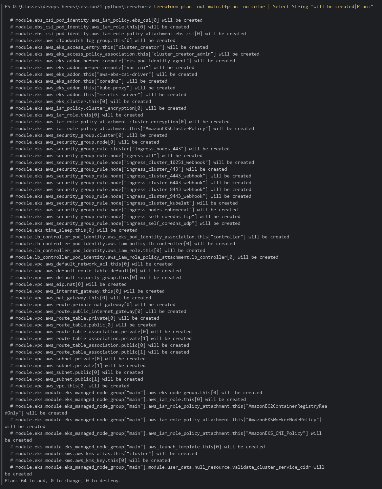
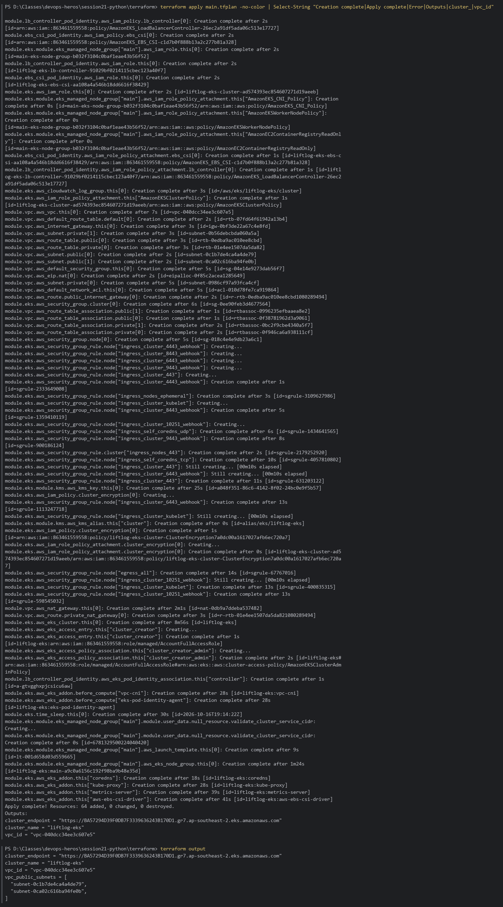
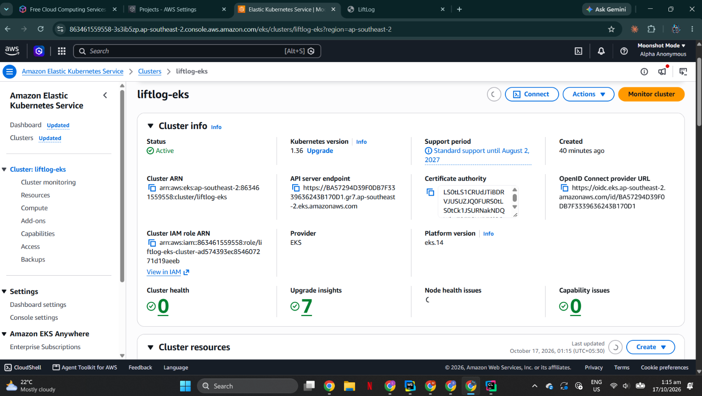
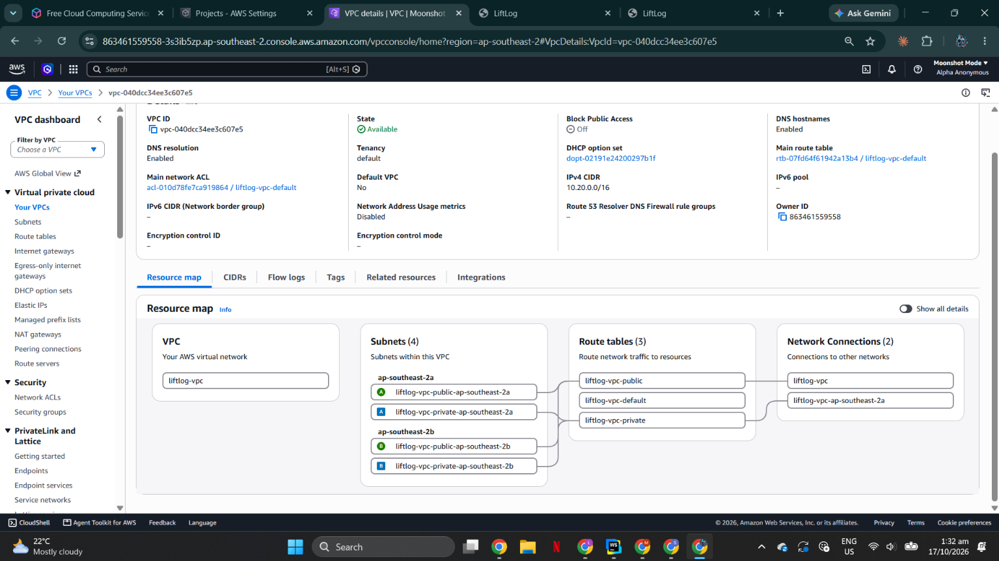
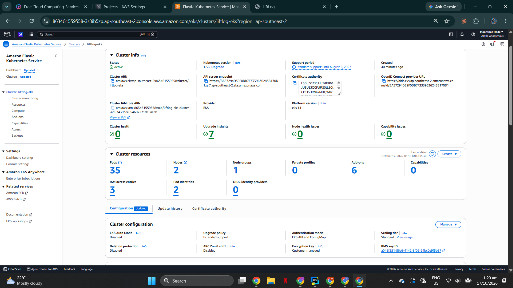
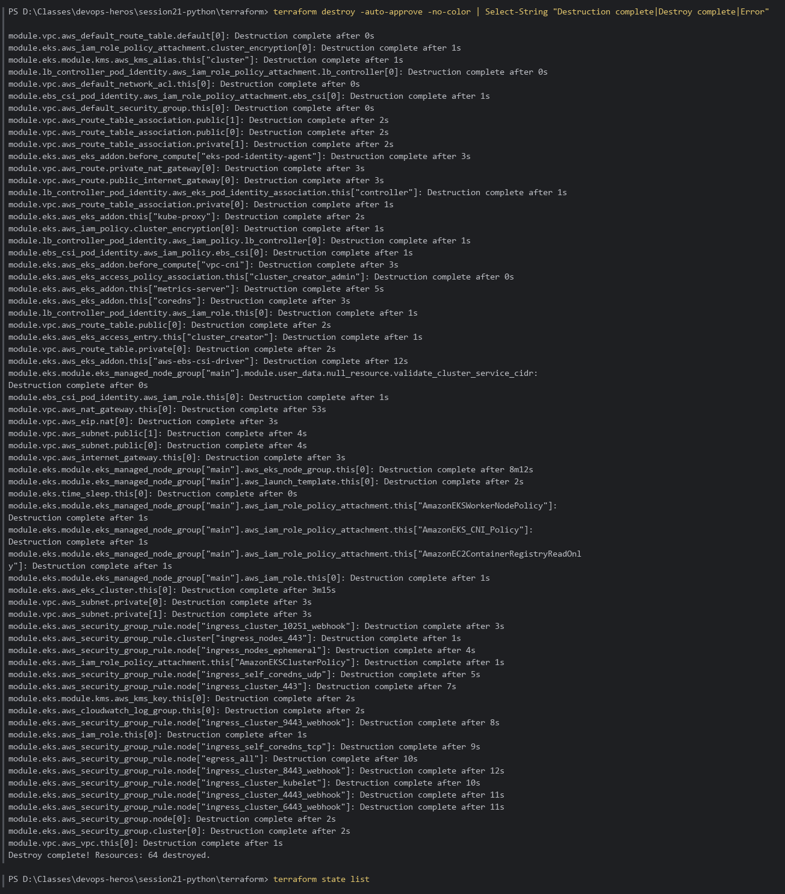

---

## M8 — Kubernetes + Helm

```powershell
aws eks update-kubeconfig --region ap-southeast-2 --name liftlog-eks --alias liftlog-eks
kubectl apply -f k8s/namespace.yaml -f k8s/storageclass.yaml
helm upgrade --install aws-load-balancer-controller eks/aws-load-balancer-controller -n kube-system --set clusterName=liftlog-eks --set serviceAccount.name=aws-load-balancer-controller --set region=ap-southeast-2 --set vpcId=<vpc-id>
helm upgrade --install liftlog ./helm/liftlog -n liftlog -f helm/liftlog/values-eks.yaml --wait
```

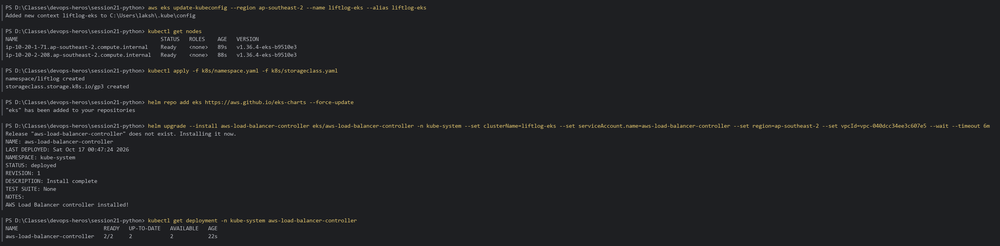
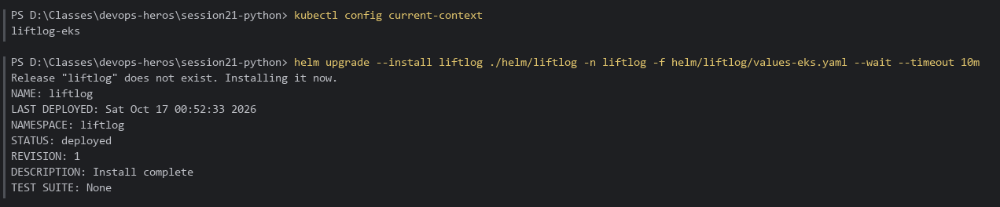

| Requirement | Evidence |
| :--- | :--- |
| `k8s/namespace.yaml` applies | `namespace/liftlog created` |
| Chart with `Chart.yaml`, `values.yaml`, templates | [`helm/liftlog/`](../helm/liftlog) |
| Backend and frontend with ≥ 2 replicas each | 2 + 2 pods `Running`, spread over both nodes/AZs; HPA 2–6 on CPU |
| ClusterIP Services | `liftlog-backend`, `liftlog-frontend`, `liftlog-postgres` (+ the `backend` alias that nginx proxies to) |
| Ingress `/` → frontend, `/api` → backend | ALB `k8s-liftlog-liftlog-…elb.amazonaws.com`, class `alb` |
| All pods `Running` | `kubectl get pods -n liftlog` |

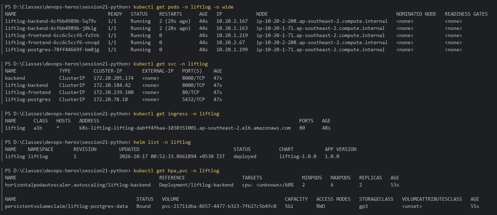
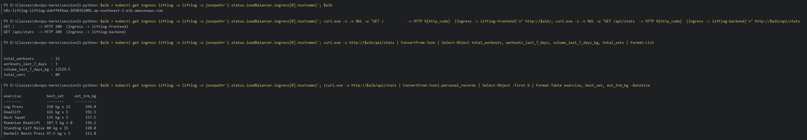


---

## M9 — Observability

`kube-prometheus-stack` with [`monitoring/prometheus-values.yaml`](../monitoring/prometheus-values.yaml); the chart's `ServiceMonitor` scrapes `/metrics` on the backend every 15s; the Grafana dashboard is code ([`monitoring/liftlog-dashboard.yaml`](../monitoring/liftlog-dashboard.yaml)): targets UP, requests/s, workouts logged, memory, request rate and p95 latency by handler, pod CPU, responses by status.

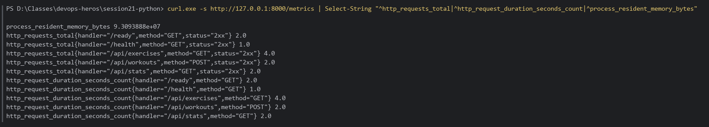
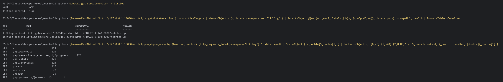
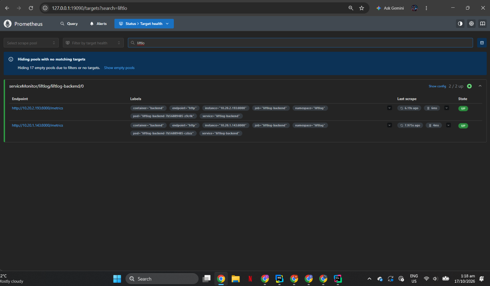
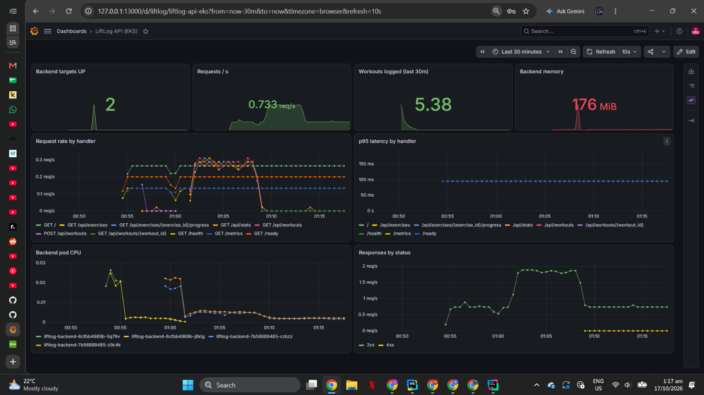

---

## M10 — Live demo: commit → pipeline → deployment

Deployments use **GitOps**. CI never touches the cluster; it records the new image SHA in Git, and **Argo CD** on EKS ([`argocd/liftlog-application.yaml`](../argocd/liftlog-application.yaml), `automated` + `selfHeal`) applies it. This avoids storing AWS credentials in GitHub. The project's service control policy also blocks the GitHub OIDC provider that CI would otherwise need.

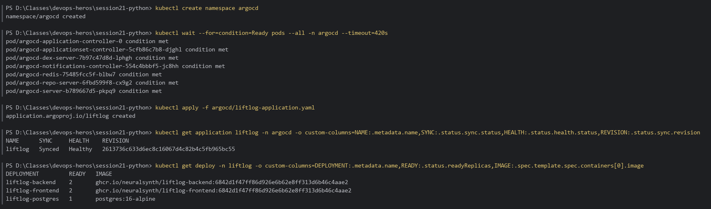
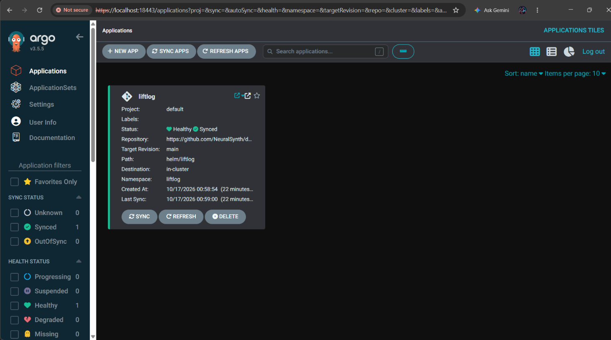

**The demo, recorded:**

1. **Before:** the ALB serves "Let's lift" from image `…:6842d1f…`.
2. Change the dashboard greeting, then `git commit` (signed) and `git push`.
3. The pipeline runs: `test` ✓ → `build-scan-push` ✓ → `update-gitops` ✓, and `github-actions[bot]` commits `deploy: liftlog images 1ac452a`.
4. Argo CD syncs that commit, the frontend rolls to `…:1ac452a…`, and the ALB serves **"Ready to train?"**.

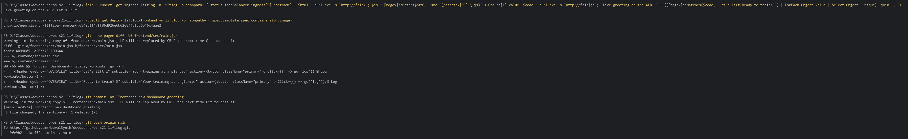
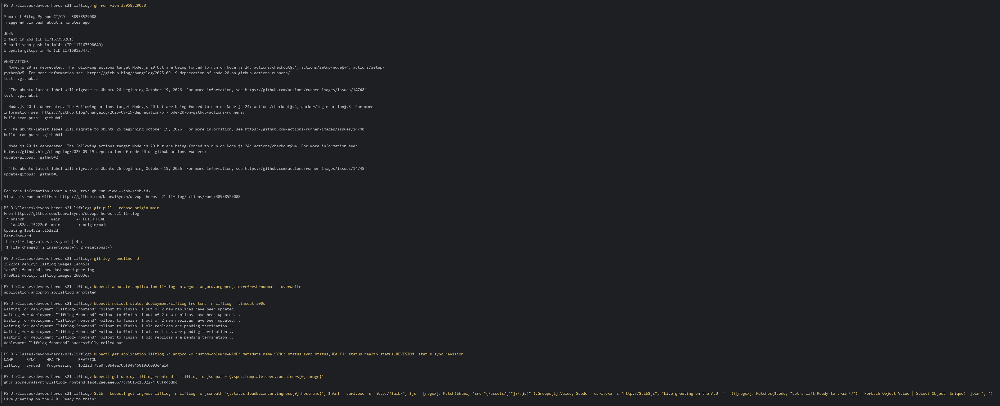

To repeat it live: use the working copy at `D:\Classes\devops-heros-s21-liftlog`, make any visible change, push, and refresh the app after ~3 minutes. The cluster has to be recreated first (see the project README); it was destroyed after recording.

---

## Engineering notes

Problems found and fixed while building this:

| Area | Problem → fix |
| :--- | :--- |
| Terraform | Invalid one-line HCL blocks → normal blocks. AWS provider v5 can't use `aws login` → provider 6.59+ with VPC/EKS modules 6.x/21.x. |
| Terraform | Kubernetes 1.31 was in extended support (6× price) → **1.36**. `t3.medium` isn't free-plan eligible → `m7i-flex.large`, capped at 2 nodes for the 5-vCPU quota. AZs were hardcoded to Mumbai → derived from the region. |
| Terraform | The service control policy denies the IAM OIDC provider (IRSA) → `enable_irsa = false`, with **EKS Pod Identity** for the EBS CSI driver and the LB controller. |
| Kubernetes | The PVC stayed `Pending` (no CSI driver or default class) → EBS CSI add-on + default `gp3` StorageClass. Postgres `initdb` failed on EBS `lost+found` → `PGDATA` in a subdirectory. |
| Helm | nginx proxies to `backend:8000`, but the Service had another name → `backend` alias Service. The Ingress pointed at a non-existent Service/port → fixed and made configurable (ALB by default). |
| Compose | Backend started before Postgres was ready → healthcheck + `service_healthy` + `restart: on-failure`. |
| Security | Trivy gate failures → FastAPI/starlette upgrade (startup moved to `lifespan`), non-root `nginx-unprivileged` base. |
| CI | Uppercase GHCR owner → lowercase image prefix. `trivy-action@0.30.0` no longer resolves → `@v0.36.0`. |
| Ops | Cleanup order: delete the Argo CD app → `helm uninstall` (Ingress → ALB, PVC → EBS) → remove controllers → `terraform destroy`, so nothing is left outside Terraform's state. |

---

## Submission checklist

```text
Application      [x] repo URL  [x] docker compose up --build  [x] 11 REST endpoints  [x] Alembic migration
Testing          [x] pytest passes (14)  [x] ≥ 5 tests
Docker           [x] backend builds  [x] frontend multi-stage  [x] non-root in both
CI/CD            [x] workflow  [x] runs on push to main  [x] pytest in pipeline  [x] GHCR with SHA tags
Security         [x] Trivy on both images  [x] no secrets committed
Terraform        [x] plan  [x] VPC + EKS (console screenshots)  [x] destroy
Kubernetes+Helm  [x] pods Running  [x] helm list  [x] app via Ingress (ALB)
Observability    [x] /metrics  [x] Prometheus targets UP  [x] Grafana dashboard
Documentation    [x] README.md  [ ] presentation (live demo flow above is ready)
```
